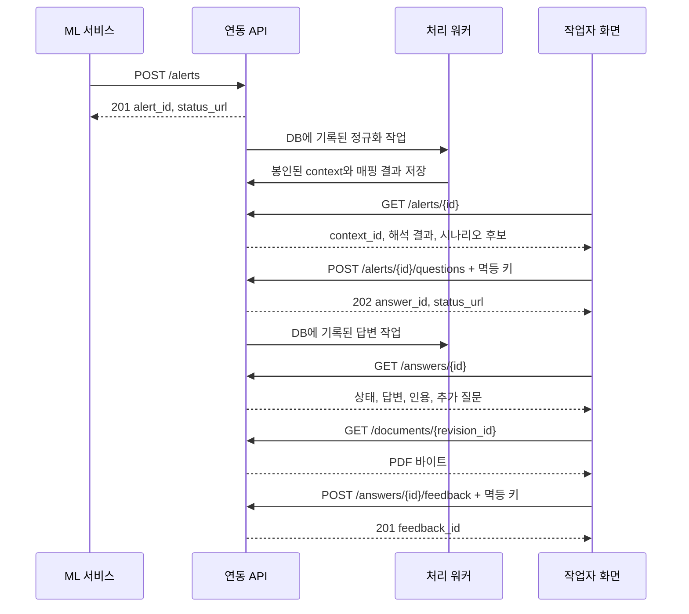

# RSW 정비 안내 MVP — 임시 연동 API 상세 명세

계약 버전: `1.0.0-draft` · 작성일: 2026-09-26

이 문서는 [기존 PostgreSQL 스키마](../schema/SCHEMA.md)에 연결하는 구현 전 명세다. 원문 수집, 온톨로지 편집, 검토·배포 API는 포함하지 않는다. ML의 실제 README 5.10과 수신 샘플은 아직 대조하지 않았으므로, 아래 envelope를 임시 계약으로 사용하고 기존 송신 형식이 다르면 어댑터를 둔다.

모든 JSON 예시의 코드·모델·수치·UUID·문서·페이지는 **형식 설명용 합성 데이터**다. 실제 Festo 경보나 정비 기준으로 사용하지 않는다. 기계가 읽는 전체 정의는 [openapi.json](openapi.json), 복사할 예시는 [examples.json](examples.json)에 있다.

## 1. 엔드포인트와 호출 순서

기존 5개 API를 유지하고, 비동기 답변 결과를 조회하기 위해 **`GET /api/v1/answers/{id}` 1개를 추가**한다. `POST questions`에서 완료된 답변을 기다리게 하지 않고 접수 결과를 반환한다.

| API | 정상 HTTP | 역할 |
|---|---|---|
| `POST /api/v1/alerts` | 신규 `201`, 동일 사건 재수신 `200` | 원본 경보와 정규화 작업을 저장 |
| `GET /api/v1/alerts/{id}` | `200` | 수신 원본, 해석 상태, 관련 시나리오 조회 |
| `POST /api/v1/alerts/{id}/questions` | `202` | 특정 해석 결과에 대한 질문 실행 접수 |
| **`GET /api/v1/answers/{id}`** | `200` | 답변 상태·근거·추가 질문·문서 절 조회 |
| `GET /api/v1/documents/{revision_id}` | `200`, 범위 요청 `206`, 캐시 검증 `304` | 봉인된 판본의 원본 PDF 제공 |
| `POST /api/v1/answers/{id}/feedback` | `201` | 적절성·오류 유형·의견 기록 |



## 2. 공통 규칙

### 2.1 식별자·시간·데이터 타입

| 항목 | 규칙 |
|---|---|
| `event_id` | 생산자가 만든 사건 ID. `(producer_key, event_id)` 조합이 유일 |
| URL의 alert `{id}` | 서버가 발급한 `alert_id` UUID. `event_id`를 URL에 넣지 않는다. |
| `context_id` | 하나의 경보를 특정 장비 구성·지식 버전으로 해석한 봉인 결과 |
| answer `{id}` | `answer_id = assistant_runs.id`. 별도 answers 테이블은 만들지 않는다. |
| `revision_id` | `document_revisions.id`. 파일명이나 매뉴얼 제목이 아니다. |
| 시간 | RFC 3339, 요청에는 `Z` 또는 UTC offset 필수. 응답은 UTC `Z` |
| 문자열/NULL | 생략 가능 여부와 NULL 허용 여부는 별개. 빈 문자열과 미확인값을 혼용하지 않는다. |
| 단위 | 원시 값과 단위를 함께 전달. 미확인 단위를 서버가 추정하지 않는다. |
| 알 수 없는 필드 | 스키마에 없는 필드는 `422`. 확장 객체로 명시된 부분만 자유 JSON 허용 |
| 수치 | JSON number 사용. NaN/Infinity 및 중복 JSON 키는 `400` |
| 요청 크기 | 경보 최대 1 MiB, 질문/피드백 최대 64 KiB. 초과 시 `413` |
| 문자열 길이 | 스키마의 길이는 Unicode code point 수. 요청 바이트 제한과 별도로 적용 |

JSON은 UTF-8 `application/json`을 사용한다. 지원하지 않는 Content-Encoding은 `415`로 거절한다. 수신 원본은 애플리케이션이 실제로 받은 JSON 바이트를 저장한다. 전송 인증 헤더나 HTTP 프레이밍을 raw payload에 넣지 않는다.

### 2.2 인증과 헤더

| 헤더 | 적용 | 규칙 |
|---|---|---|
| `Authorization: Bearer …` | 전 API | ML용 서비스 토큰 또는 사용자 토큰. 토큰 발급 API는 별도 |
| `Content-Type: application/json` | POST 3개 | 필수 |
| `Idempotency-Key` | 질문·피드백 POST | 필수. 새 논리적 요청마다 새 키; 재시도는 같은 키 |
| `X-Request-ID` | 응답 | 서버가 생성한 요청 추적 UUID |
| `Location` | 경보 신규 접수·질문 접수 | 해당 조회 API의 상대 URL |
| `Retry-After` | 대기 조회·일시적 거절 | 재조회/재시도까지 권장 초. 초기 권장 2초 |
| `Idempotency-Replayed` | 질문·피드백 응답 | `true`이면 최초 응답 재생. 이 계약에서 정의한 자체 헤더 |

ML 서비스는 허용된 `producer_key`로만 경보를 등록할 수 있다. 화면 사용자는 접근 가능한 장비·경보·문서만 조회한다. `requested_by`, `reviewer_id`, `release_id`, `asset_config_id`는 서버가 결정하며 임의의 본문 값으로 받지 않는다. 역할과 리소스 접근 검사는 API 서비스가 구현하고 DB의 `actors.role` 값만으로 자동 인증된다고 가정하지 않는다.

JSON 응답은 `Cache-Control: no-store`. PDF는 인증 후 `Cache-Control: private, no-cache`로 브라우저 재검증을 사용한다. 외부에서 접근한다면 HTTPS로 제공한다.

### 2.3 재전송·중복 처리

**경보:** 인증된 생산자와 `event_id`를 기준으로 기존 행을 조회한다. 동일성은 엄격하게 파싱한 원본 JSON 객체의 PostgreSQL JSONB 구조적 동등성으로 판단한다. 공백·객체 키 순서와 동등한 수치 표기 차이는 무시하지만, 배열 순서·필드 생략과 명시적 NULL·문자열 내용 차이는 구분한다. 기본값을 채우기 전의 제출 객체끼리 비교한다.

- 처음 받은 사건: `201`, 원본과 정규화 작업을 한 번 생성한다.
- 같은 사건·같은 JSON: `200`, 최초 `alert_id/received_at`을 반환한다. 현재 작업 상태를 함께 제공하되 새 작업을 만들지 않는다.
- 같은 사건·다른 JSON: `409 EVENT_ID_CONFLICT`, 덮어쓰지 않는다.
- 같은 JSON을 다른 event ID로 보내면 별도 사건이다. 수정이 필요하면 새 사건 ID를 사용한다.
- `payload_sha256`는 원본 바이트 보존 확인용이다. 이 해시 하나로 JSON의 동일성을 판단하지 않는다. 최초 raw bytes만 보존한다.

`parsed_payload`에는 검증 DTO에 기본값을 채워 재직렬화한 객체가 아니라 제출된 JSON 객체 자체를 저장한다. 원본 보존과 타입 검증·정규화 결과를 구분해야 위 중복 비교 규칙이 유지된다.

**질문·피드백:** `(인증 주체, HTTP 메서드, 정규화된 리소스 경로, Idempotency-Key)`를 유일 키로 사용하고 최초 접수 후 **최소 24시간** 기록을 보관한다. 같은 키·같은 JSON이면 최초 HTTP 상태와 body를 재생하고, 추적용 `X-Request-ID`는 새 요청의 값을 반환한다. 다른 JSON이면 `409 IDEMPOTENCY_KEY_REUSED`다. 키의 유효 문자는 영문·숫자·`.`·`_`·`:`·`-`, 길이 1~128이다.

질문 응답의 최초 `status=pending`도 그대로 재생한다. 실제 상태는 `GET answers`로 확인한다. 이미 실패한 실행을 새로 처리하려면 새 키로 새 질문 실행을 만들어야 한다. 24시간 이후에는 중복 방지를 보장하지 않으므로, 그 전에 받은 리소스 ID로 조회하는 것이 우선이다.

같은 키의 동시 요청은 DB UNIQUE와 트랜잭션으로 하나만 생성한다. 첫 트랜잭션 종료를 짧게 기다린 뒤에도 미완료이면 `409 REQUEST_IN_PROGRESS`와 `Retry-After`를 반환한다. 유효하지 않은 요청과 인증 실패는 멱등 성공 기록을 만들지 않는다. 큐 저장 실패로 트랜잭션이 롤백된 경우에는 같은 키로 재시도할 수 있다.

## 3. POST /api/v1/alerts — 경보 수신

**호출자:** 등록된 ML 생산자 서비스. **입력:** `AlertInput`.

| 입력 | 필수 | 의미 |
|---|---|---|
| `schema_version` | O | 이 API의 envelope 버전, 현재 `1.0` |
| `producer_schema_version` | O | ML 송신 데이터의 계약 버전 |
| `event_id`, `producer_key` | O | 생산자 범위 사건 식별자 |
| `asset_key` | O | 원시 장비 키. MVP는 `assets.asset_code`와 매칭 |
| `occurred_at` | O | 실제 경보 발생 시각 |
| `observation_window` | 선택/NULL | `start/end`. 둘 다 제공하고 start ≤ end |
| `observed_codes` | O | `{namespace, code, observed_at?}` 배열, 최대 64개 |
| `observations` | O | 원시 feature·값/요약·단위·품질, 최대 128개 |
| `ml_assessments` | O | 분류·가설·규칙·이상 점수, 최대 64개 |
| `operating_context` | 선택 | 용접/비용접 등 입력 맥락 |

필수 배열도 데이터가 없으면 빈 배열로 보낸다. `observations[].quality='valid'`이면 NULL이 아닌 value 또는 summary가 필요하다. 수치 요약은 min ≤ max이며, mean이 함께 있으면 해당 범위 안에 있어야 한다. 직접 비교할 단위를 알 수 없거나 feature 매핑이 안 된 경우 원본을 보존하고 해석 경고를 남긴다.

ML의 `classification`은 고장 **분류**, `hypothesis`는 원인 **후보**, `rule_trigger`는 규칙 결과다. 이 세 유형에는 namespace와 code를 가진 `target`이 필요하다. `anomaly`는 원인 엔티티로 직접 확정하지 않는다. score가 `probability`이면 0~1이고, `calibrated`이면 보정 근거와 probability 종류가 필요하다. 미보정 확률 점수를 고장의 실제 발생 확률로 표시하지 않는다.

요청 예시:

```json
{
  "schema_version": "1.0",
  "producer_schema_version": "demo-ml-v1",
  "event_id": "demo-event-0001",
  "producer_key": "demo-ml",
  "asset_key": "RSW-DEMO-001",
  "occurred_at": "2026-09-26T01:00:00Z",
  "observation_window": {
    "start": "2026-09-26T00:59:50Z",
    "end": "2026-09-26T01:00:00Z"
  },
  "observed_codes": [
    {
      "namespace": "demo.dataset.raw_alarm",
      "code": "DEMO-E01",
      "observed_at": "2026-09-26T01:00:00Z"
    }
  ],
  "observations": [
    {
      "feature_key": "demo.cycle_duration",
      "value": 1.92,
      "unit": "s",
      "quality": "valid",
      "observed_at": "2026-09-26T01:00:00Z"
    }
  ],
  "ml_assessments": [
    {
      "kind": "classification",
      "model": {
        "name": "demo-classifier",
        "version": "demo-v1"
      },
      "target": {
        "namespace": "demo.dataset.fault_class",
        "code": "DEMO-F01"
      },
      "score": {
        "kind": "probability",
        "value": 0.82,
        "calibration_status": "uncalibrated"
      }
    }
  ],
  "operating_context": {
    "cycle_state": "unknown"
  }
}
```

신규 응답 `201 Created` (`Location: /api/v1/alerts/{alert_id}`):

```json
{
  "alert_id": "00000000-0000-4000-8000-000000000001",
  "event_id": "demo-event-0001",
  "producer_key": "demo-ml",
  "received_at": "2026-09-26T01:00:00Z",
  "duplicate": false,
  "normalization": {
    "status": "queued",
    "updated_at": "2026-09-26T01:00:00Z",
    "error": null
  },
  "status_url": "/api/v1/alerts/00000000-0000-4000-8000-000000000001"
}
```

처리 순서:

1. 인증·생산자 권한·JSON 계약·크기를 검사한다.
2. 동일 사건을 먼저 검사한다. 이미 저장된 동일 사건은 현재 활성 지식이 없어도 기존 결과를 반환한다.
3. 신규 사건은 활성 `published` 지식 버전이 필요하다. 없으면 `503 KNOWLEDGE_NOT_READY`; 원본과 작업 모두 저장하지 않는다. 생산자가 같은 사건으로 나중에 재시도한다.
4. **원본 경보 + 정규화 작업 + 선택한 지식/normalizer/matcher 버전**을 한 트랜잭션에 저장한다. 저장 후 외부 큐 전송만 시도하는 형태로 처리하지 않는다.
5. 워커가 장비 구성을 결정하고 코드를 매핑한다. 장비는 발생 시각 이하의 `effective_from` 후보 중 현장 정책상 유일하게 선택되는 구성을 사용한다. 동률·모호함·미등록·검증 부족은 명시하고 임의로 verified로 만들지 않는다.
6. context와 자식 관측·ML 행, 매핑 인덱스·시나리오 결과를 기록하고 봉인한다. 중간의 미봉인 context는 조회에 공개하지 않는다.

최초 작업에 고정한 지식 버전을 워커 실행 시점의 최신 배포본으로 바꾸지 않는다. 장비 구성 ID도 결과 확정 시 고정한다. 재정규화는 관리 기능에서 새로운 작업과 context로 수행하며, 이 API의 중복 전송으로 자동 수행하지 않는다.

| 실패 | 코드 | 저장 여부 |
|---|---|---|
| 같은 사건 ID의 다른 내용 | `409 EVENT_ID_CONFLICT` | 기존 데이터 유지 |
| 미등록 생산자/생산자 권한 불일치 | `403 PRODUCER_NOT_ALLOWED` | 저장 안 함 |
| 활성 지식 없음 | `503 KNOWLEDGE_NOT_READY` | 신규 사건 저장 안 함 |
| 잘못된 timestamp/배열/점수 범위 | `422 VALIDATION_ERROR` | 저장 안 함 |
| 수신 후 정규화 실패 | 최초 접수는 성공, 조회 시 `normalization.status=failed` | 원본 보존 |

## 4. GET /api/v1/alerts/{id} — 경보 상세

**입력:** 서버 `alert_id` UUID. 선택적 query `context_id`로 특정 봉인 결과를 조회할 수 있다.

생략 시 해당 경보의 가장 최근에 생성된 기본 정규화 작업을 선택한다. 그 작업이 아직 완료되지 않았다면 `context=null`이다. 이전 결과를 계속 보려면 명시적 `context_id`를 사용한다. 지정한 context는 반드시 이 경보에 속해야 하며, 그 context에 대응하는 완료 작업 상태를 반환한다.

| 출력 | 의미 |
|---|---|
| `alert_id`, `received_at` | 최초 수신 기록 |
| `submitted_event` | 최초 수신한 JSON 객체. 원본 바이트·내부 저장 경로는 공개하지 않음 |
| `normalization` | `queued/running/succeeded/failed` 작업 상태와 실패 정보 |
| `context` | 봉인된 결과 또는 NULL. 지식 버전·장비 구성·매핑·경고 포함 |
| `related_scenarios` | `not_evaluated/matched/no_match/failed`와 관련 시나리오 후보 |

`context.status` 의미:

- `mapped`: 필요한 장비 구성/입력 매핑이 정규화 계약상 충분하다. 이것만으로 원인이나 정비 절차 적용이 승인된 것은 아니다.
- `partial`: 일부 매핑·맥락은 사용 가능하지만 미확인 사항이 있다.
- `unmapped`: 원문은 보존했으나 유용한 지식 매핑이 없다.
- `invalid`: JSON 계약은 통과했으나 도메인 의미상 해석할 수 없는 모순이 있다. 이 context로 질문 실행을 시작하지 않는다.

invalid라는 판정을 정상적으로 저장·봉인했다면 정규화 작업 자체는 succeeded다. 워커/DB 오류로 판정 결과를 만들지 못한 failed와 구분한다.

응답 예시 `200 OK`:

```json
{
  "alert_id": "00000000-0000-4000-8000-000000000001",
  "received_at": "2026-09-26T01:00:00Z",
  "submitted_event": {
    "schema_version": "1.0",
    "producer_schema_version": "demo-ml-v1",
    "event_id": "demo-event-0001",
    "producer_key": "demo-ml",
    "asset_key": "RSW-DEMO-001",
    "occurred_at": "2026-09-26T01:00:00Z",
    "observation_window": {
      "start": "2026-09-26T00:59:50Z",
      "end": "2026-09-26T01:00:00Z"
    },
    "observed_codes": [
      {
        "namespace": "demo.dataset.raw_alarm",
        "code": "DEMO-E01",
        "observed_at": "2026-09-26T01:00:00Z"
      }
    ],
    "observations": [
      {
        "feature_key": "demo.cycle_duration",
        "value": 1.92,
        "unit": "s",
        "quality": "valid",
        "observed_at": "2026-09-26T01:00:00Z"
      }
    ],
    "ml_assessments": [
      {
        "kind": "classification",
        "model": {
          "name": "demo-classifier",
          "version": "demo-v1"
        },
        "target": {
          "namespace": "demo.dataset.fault_class",
          "code": "DEMO-F01"
        },
        "score": {
          "kind": "probability",
          "value": 0.82,
          "calibration_status": "uncalibrated"
        }
      }
    ],
    "operating_context": {
      "cycle_state": "unknown"
    }
  },
  "normalization": {
    "status": "succeeded",
    "updated_at": "2026-09-26T01:00:01Z",
    "error": null
  },
  "context": {
    "context_id": "00000000-0000-4000-8000-000000000002",
    "knowledge_release_id": "00000000-0000-4000-8000-000000000003",
    "knowledge_version": "demo-kb-v1",
    "normalizer_version": "demo-normalizer-v1",
    "status": "partial",
    "asset": {
      "reported_key": "RSW-DEMO-001",
      "asset_id": "00000000-0000-4000-8000-000000000007",
      "asset_config_id": null,
      "verification_status": "unresolved"
    },
    "code_mappings": [
      {
        "id": "00000000-0000-4000-8000-000000000013",
        "input_index": 0,
        "entity_id": null,
        "status": "unmapped"
      }
    ],
    "observation_mappings": [
      {
        "id": "00000000-0000-4000-8000-000000000014",
        "input_index": 0,
        "feature_id": null,
        "binding_id": null,
        "status": "unmapped"
      }
    ],
    "ml_mappings": [
      {
        "id": "00000000-0000-4000-8000-000000000015",
        "input_index": 0,
        "target_entity_id": null,
        "target_kind": null
      }
    ],
    "warnings": [
      {
        "code": "ASSET_CONFIG_UNRESOLVED",
        "message": "예시 장비의 구성 정보를 확인해야 합니다.",
        "field": "asset_key"
      }
    ],
    "sealed_at": "2026-09-26T01:00:01Z"
  },
  "related_scenarios": {
    "status": "no_match",
    "matcher_version": "demo-matcher-v1",
    "items": [],
    "error": null
  }
}
```

`input_index`는 최초 입력 배열의 **0부터 시작하는 위치**다. 중복 원시 코드가 있더라도 결과를 정확한 입력 항목에 연결하기 위해 사용한다. 이 위치는 기존 DB 컬럼에 없으므로 서버 매핑 메타데이터에 저장해야 한다.

시나리오 매칭은 해당 context의 지식 버전으로 수행한 파생 결과다. `match_methods`, 관계 ID, 설명을 함께 남기며 원인 확정이나 확률로 해석하지 않는다. `no_match`는 검사를 했지만 후보가 없다는 뜻이고 `not_evaluated`와 다르다. 정규화는 성공했어도 시나리오 매칭만 실패할 수 있다.

경보가 존재하면 정규화 대기/실패 상태도 HTTP `200`이다. 리소스 없음은 `404`, UUID 형식 오류는 `422`다.

## 5. POST /api/v1/alerts/{id}/questions — 질문 접수

**호출자:** 작업자/허용된 사용자. `Idempotency-Key` 필수. **입력:** `QuestionInput`.

| 필드 | 필수 | 설명 |
|---|---|---|
| `context_id` | O | 화면에서 조회한 봉인 context UUID |
| `question` | O | 1~2,000자, 공백만 있는 질문 불가 |
| `reply_to_answer_id` | 선택/NULL | 같은 context의 이전 완료 답변 |
| `context_answers` | 선택 | 이전 답변이 요청한 구조화 질문에 대한 응답. 최대 20개 |

요청 예시:

```json
{
  "context_id": "00000000-0000-4000-8000-000000000002",
  "question": "이 경보가 의미하는 것과 먼저 확인할 정보를 알려주세요."
}
```

응답 `202 Accepted` (`Location`과 `status_url`은 답변 조회 API):

```json
{
  "answer_id": "00000000-0000-4000-8000-000000000004",
  "alert_id": "00000000-0000-4000-8000-000000000001",
  "context_id": "00000000-0000-4000-8000-000000000002",
  "knowledge_release_id": "00000000-0000-4000-8000-000000000003",
  "status": "pending",
  "status_url": "/api/v1/answers/00000000-0000-4000-8000-000000000004",
  "created_at": "2026-09-26T01:00:05Z"
}
```

검증·저장 규칙:

1. context가 URL의 경보에 속하는지, 봉인됐는지 검사한다. context의 release를 고정한다. 현재 활성 배포본을 다시 선택하지 않는다.
2. `partial`·`unmapped`도 설명과 추가 정보 수집을 위한 질문은 허용한다. `invalid`는 `409 CONTEXT_NOT_USABLE`이다.
3. 이전 답변을 참조하면 같은 경보·context·release이며 `answered/needs_context/insufficient_evidence`로 완료됐는지 확인한다.
4. context_answers가 하나라도 있으면 reply_to_answer_id가 필수다. question_key 중복·미정의 키·자료형·선택지·단위 오류는 `422`다. 숫자/boolean을 임의로 문자열로 변환해 수용하지 않는다.
5. 모델·프롬프트·검색기·임베딩 버전 및 질문 원문, reply 관계, 구조화 입력을 처음부터 고정한다. `assistant_runs + 답변 작업 + 멱등 기록`을 한 트랜잭션으로 저장한다.
6. 워커는 근거와 인용을 모두 저장한 후 run을 완료한다. 완료 후 추가 인용을 넣는 순서는 기존 DB 트리거와 맞지 않는다.

### 추가 질문에 답하는 방식

```json
{
  "context_id": "00000000-0000-4000-8000-000000000002",
  "question": "비용접 상태에서 발생했습니다. 이 정보를 반영해 설명해주세요.",
  "reply_to_answer_id": "00000000-0000-4000-8000-000000000004",
  "context_answers": [
    {
      "question_key": "cycle_state",
      "value": "non_welding",
      "unit": null
    }
  ]
}
```

후속 질문도 새 answer_id를 만든다. 이전 답변이나 봉인된 ML context를 수정하지 않는다. 이전 답변 체인의 사용자 입력은 출처와 시각을 보존해서 승계하며, 해당 응답이 명시적으로 갱신하는 사용자 제공 필드만 새 값으로 반영한다. 체인 깊이는 v1에서 20으로 제한하고 초과 시 `422 CONVERSATION_LIMIT_EXCEEDED`다.

작업자 제공 정보는 `operator_reported`로 취급한다. ML 입력의 unknown을 보완할 수 있지만 이미 알려진 값과 다르면 양쪽을 보존하고 충돌로 표시한다. 작업자가 모델명을 말한 것만으로 검토된 asset_config나 applicable 판정을 바꾸지 않는다. 구조화된 field key는 배포본/서버 계약의 허용 목록으로 검사하며 임의 속성 쓰기를 허용하지 않는다.

| 상황 | 응답 |
|---|---|
| 아직 정규화/봉인이 완료되지 않음 | `409 ALERT_NOT_READY` |
| URL의 경보와 다른 context | `409 CONTEXT_ALERT_MISMATCH` (호출자가 두 리소스에 접근 가능한 경우) |
| 이전 답변과 다른 context/release | `409 REPLY_CONTEXT_MISMATCH` |
| 이전 답변이 pending/running | `409 ANSWER_NOT_READY` |
| 정의되지 않은 추가 질문 응답 | `422 VALIDATION_ERROR` |
| 동일 멱등 키에 다른 요청 | `409 IDEMPOTENCY_KEY_REUSED` |

## 6. GET /api/v1/answers/{id} — 상태·답변 결과

추가하는 조회 API다. 작업자는 기본 2초 간격으로 조회하고 장기 대기는 간격을 늘린다. 완료 상태를 받으면 조회를 멈춘다. 실패 작업은 같은 POST 키를 반복해도 재실행되지 않는다.

| 상태 | 의미 | result / error |
|---|---|---|
| `pending` | 실행 대기 | NULL / NULL |
| `running` | 처리 중 | NULL / NULL |
| `answered` | 질문에 대해 근거 있는 응답을 완료 | 객체 / NULL |
| `needs_context` | 추가 정보가 있어야 안내 가능 | 객체 / NULL, 추가 질문 최소 1개 |
| `insufficient_evidence` | 현재 지식과 적용성으로 충분한 근거를 확보하지 못함 | 객체 / NULL |
| `failed` | 모델 타임아웃 등 시스템 처리 실패 | NULL / 오류 객체 |

리소스가 존재하면 위 상태 모두 HTTP `200`이다. `needs_context`를 `422`로, `failed` 상태 조회를 `500`으로 바꾸지 않는다. GET API 자체가 실패했을 때만 HTTP 오류를 사용한다.

완료 응답 예시:

```json
{
  "answer_id": "00000000-0000-4000-8000-000000000004",
  "alert_id": "00000000-0000-4000-8000-000000000001",
  "context_id": "00000000-0000-4000-8000-000000000002",
  "knowledge_release_id": "00000000-0000-4000-8000-000000000003",
  "reply_to_answer_id": null,
  "status": "needs_context",
  "question": "이 경보가 의미하는 것과 먼저 확인할 정보를 알려주세요.",
  "started_at": "2026-09-26T01:00:05Z",
  "finished_at": "2026-09-26T01:00:10Z",
  "result": {
    "summary": "현재 정보로는 장비에 맞는 정비 절차를 확정할 수 없습니다. 운전 상태와 등록된 장비 구성을 추가로 확인해야 합니다.",
    "claims": [
      {
        "claim_key": "observed-code",
        "type": "observation",
        "text": "수신 데이터에 예시 코드 DEMO-E01이 포함되어 있습니다.",
        "citation_ids": [],
        "event_evidence": [
          {
            "kind": "observed_code",
            "id": "00000000-0000-4000-8000-000000000013"
          }
        ]
      }
    ],
    "procedures": [],
    "follow_up_questions": [
      {
        "question_key": "cycle_state",
        "field": "operating_context.cycle_state",
        "prompt": "경보 발생 당시 용접 중이었나요?",
        "value_type": "string",
        "required": true,
        "options": [
          {
            "value": "welding",
            "label": "용접 중"
          },
          {
            "value": "non_welding",
            "label": "비용접 상태"
          }
        ],
        "unit": null
      }
    ],
    "citations": [],
    "notices": [
      {
        "code": "ASSET_CONFIG_UNRESOLVED",
        "message": "장비 구성 확인은 도메인 담당자의 별도 검토가 필요합니다.",
        "field": "asset_key"
      }
    ]
  },
  "error": null
}
```

`result`의 구성:

| 필드 | 역할 |
|---|---|
| `summary` | 작업자가 읽을 요약. 아래 근거 있는 주장과 일치해야 함 |
| `claims` | 관측 사실/가설/매뉴얼 사실/절차 안내/한계의 구분 및 근거 연결 |
| `procedures` | 실제 장비 적용과 조건을 확인한 절차. 무근거 절차 생성 금지 |
| `follow_up_questions` | question_key, field, 입력 타입, 선택지, 단위를 가진 추가 질문 |
| `citations` | 원문 인용과 문서 절·판본·실제 페이지·인쇄 쪽수 |
| `notices` | 미확인 사항, 비교 자료, 적용 제한, 충돌에 대한 안내 |

인용 객체 예시(실제 매뉴얼 인용이 아님):

```json
{
  "citation_id": "00000000-0000-4000-8000-000000000012",
  "claim_key": "example-manual-scope",
  "section_id": "00000000-0000-4000-8000-000000000009",
  "section_title": "예시 적용 범위",
  "section_number": "2.1",
  "span_id": "00000000-0000-4000-8000-000000000010",
  "document_revision_id": "00000000-0000-4000-8000-000000000011",
  "document_title": "형식 설명용 가상 매뉴얼",
  "document_url": "/api/v1/documents/00000000-0000-4000-8000-000000000011",
  "quote": "이 인용문은 API 형식 설명용 가상 데이터이며 실제 매뉴얼의 내용이 아닙니다.",
  "reference_scope": "analogous",
  "locator": {
    "kind": "pdf_page",
    "page_number": 12,
    "printed_page_label": "10",
    "char_start": null,
    "char_end": null,
    "bbox": null
  }
}
```

근거 규칙:

- citation ID는 실제 저장된 `answer_citations.id`. quote는 원문 span에서 서버가 추출하고 LLM이 원문처럼 새로 만들게 두지 않는다.
- citation의 claim_key는 `claims[].claim_key`에 존재해야 한다. claim_key는 답변 안에서 유일하다. 절차 단계도 claim_key를 가지며 해당 `procedure_guidance` 주장과 연결한다. 모든 citation/event evidence는 같은 context/release의 허용된 자료여야 한다.
- 관측 사실은 `event_evidence`로 코드/관측/ML 행을 참조할 수 있다. 이 경우 매뉴얼 인용이 없을 수 있다. ML 출력 자체를 실제 원인 확인으로 해석하지 않는다.
- 매뉴얼 사실과 절차 안내는 원문 근거가 필요하다. `analogous/comparison/unknown` 자료는 배경 설명으로만 표시하고 절차 수행의 근거로 사용하지 않는다.
- `needs_context`와 `insufficient_evidence`의 procedures는 빈 배열이다. `answered`여도 설명형 질문이면 procedures가 비어 있을 수 있다.
- 절차의 precondition, 필요한 역할, 적용성, 각 단계의 branch_condition을 함께 검사한다. 조건 없는 단계는 `unconditional`, 알려진 입력으로 조건 충족을 확인한 단계는 `satisfied`와 condition_summary를 반환한다. 미확정 분기를 무조건적인 순서로 펴서 반환하지 않는다.
- 전체 안내 경로의 조건을 현재 정보로 정할 수 없으면 절차를 내보내지 않고 추가 확인 또는 근거 부족으로 처리한다. 수행 후 관측에 따라 진행하는 자동 절차 실행 엔진은 v1에 포함하지 않는다.

bbox는 좌상단 원점, 오른쪽 +x, 아래쪽 +y, `[x0,y0,x1,y1]` 순서의 0~1 정규화 좌표다. PDF의 원래 좌표계가 다르면 추출 과정에서 변환한다. 문자열 offset은 페이지 텍스트의 Unicode code point 기준 `[start,end)`다. 값의 실제 범위와 인용문 일치는 서비스가 검사한다.

## 7. GET /api/v1/documents/{revision_id} — PDF

**대상:** 등록·봉인된 **원본 PDF**. JSON wrapper를 반환하지 않는다. revision UUID로 내부 저장 위치를 찾으며 임의 파일 경로/URL을 입력으로 받지 않는다.

전체 파일:

```http
GET /api/v1/documents/00000000-0000-4000-8000-000000000011
Authorization: Bearer <token>
Accept: application/pdf

HTTP/1.1 200 OK
Content-Type: application/pdf
Content-Disposition: inline; filename="manual.pdf"
ETag: "sha256-<실제 제공 파일의 해시>"
Accept-Ranges: bytes
Cache-Control: private, no-cache
Content-Length: <전체 바이트 수>

<PDF bytes>
```

| 입력/상태 | 계약 |
|---|---|
| `Range: bytes=0-1023` | 단일 byte 범위 지원. 만족하면 `206`, Content-Range와 해당 길이 반환 |
| `Range: bytes=1024-` / `bytes=-1024` | 열린 끝/접미 범위도 지원 |
| 만족할 수 없는 단일 byte 범위 | `416 RANGE_NOT_SATISFIABLE`, `Content-Range: bytes */TOTAL` |
| 잘못된 Range·다중 범위 | v1은 Range를 무시하고 `200` 전체 파일 반환 |
| `If-None-Match` 일치 | 인증 후 `304`, body 없음. Range 평가보다 우선 |
| `If-Range` | 서버가 발급한 강한 ETag와 일치할 때만 Range 적용. 불일치/지원하지 않는 날짜/약한 validator는 `200` 전체 파일 |
| 알려진 판본이 PDF가 아님 | `409 DOCUMENT_NOT_PDF` |
| 판본이 아직 봉인되지 않음 | `409 DOCUMENT_NOT_SEALED` |
| 판본 없음 | `404 DOCUMENT_NOT_FOUND` |
| 메타데이터는 있으나 실제 파일 없음/해시 불일치 | `503 DOCUMENT_STORAGE_UNAVAILABLE` 또는 `DOCUMENT_INTEGRITY_ERROR`; 불일치 파일을 제공하지 않음 |

Range는 바이트 범위이며 페이지 범위가 아니다. 파일은 변경 불가 저장소에 두고 등록 시 실제 MIME/파일 형식과 해시를 검사한다. 제공 파일이 바뀌지 않았는지 확인하는 정책도 필요하다. 경로 확장자만으로 PDF 여부를 판단하지 않는다.

화면에서는 citation의 `locator.page_number`를 사용한다. `printed_page_label`은 표시용 문자열이다. `#page=12`는 브라우저 fragment이므로 서버에 전달되지 않으며, PDF 뷰어에 따라 지원이 다르다. **Bearer 인증을 사용하는 MVP에서는 PDF.js 등에서 인증 헤더를 붙여 파일을 받고 해당 페이지로 이동하는 방식**을 권장한다. 토큰을 URL 쿼리에 넣지 않는다.

`locator.kind='logical_block'`이면 PDF 점프 링크를 만들지 않는다. DOCX/노트를 PDF로 변환해서 제공하는 기능은 별도이며, 추가할 경우 원본과 다른 해시·파일 위치·페이지 대응표가 필요하다. 이 계약은 그 변환 기능을 포함하지 않는다.

## 8. POST /api/v1/answers/{id}/feedback — 검토 의견

**호출자:** 허용된 작업자/검토자. `Idempotency-Key` 필수. **대상 상태:** `answered/needs_context/insufficient_evidence`만 허용한다.

| 필드 | 필수 | 규칙 |
|---|---|---|
| `verdict` | O | `acceptable/needs_revision/incorrect` |
| `error_categories` | O | acceptable이면 []; 나머지는 오류 유형 최소 1개 |
| `comment` | 선택/NULL | 최대 2,000자. other 선택 시 공백 아닌 설명 필수 |
| `supersedes_id` | 선택/NULL | 이전 의견 정정 시 지정. 같은 작성자·같은 answer여야 함 |

오류 유형: `wrong_equipment`, `wrong_code_mapping`, `wrong_source`, `unsupported_claim`, `missing_context`, `incorrect_procedure`, `incorrect_citation`, `other`.

요청:

```json
{
  "verdict": "needs_revision",
  "error_categories": [
    "missing_context"
  ],
  "comment": "제어기 모델 확인도 먼저 요청하면 좋겠습니다.",
  "supersedes_id": null
}
```

응답 `201 Created`:

```json
{
  "feedback_id": "00000000-0000-4000-8000-000000000006",
  "answer_id": "00000000-0000-4000-8000-000000000004",
  "reviewer_id": "00000000-0000-4000-8000-000000000005",
  "verdict": "needs_revision",
  "error_categories": [
    "missing_context"
  ],
  "comment": "제어기 모델 확인도 먼저 요청하면 좋겠습니다.",
  "supersedes_id": null,
  "created_at": "2026-09-26T01:02:00Z"
}
```

`reviewer_id`는 인증된 actor에서 정한다. 기존 feedback 행은 수정하지 않는다. 정정은 새 행을 추가하고, 이전 행을 가리키는 supersedes_id로 연결한다. 이미 정정된 행을 또 정정하려 하면 `409 FEEDBACK_ALREADY_SUPERSEDED`; 최신 정정 행을 대상으로 다시 제출한다.

같은 이전 피드백의 동시 정정은 이전 행 잠금과 재확인으로 직렬화하고, 아래 추가 유일 인덱스로도 차단한다. 다른 작성자의 의견을 정정할 권한은 v1에서 제공하지 않는다. 대상이 다른 answer면 `409 FEEDBACK_TARGET_MISMATCH`, 권한이 없으면 `403`, pending/running/failed 실행에는 `409 ANSWER_NOT_REVIEWABLE`을 반환한다.

피드백은 답변 품질에 대한 의견이다. `acceptable`이 들어와도 가설을 확정 원인으로, 유사 매뉴얼을 applicable로 자동 승격하지 않는다. 실제 정비 결과는 기존 `maintenance_outcomes`의 별도 검토 흐름에서 기록한다.

## 9. 공통 오류 응답

Content-Type은 `application/problem+json`. HTTP 상태와 body.status는 일치한다. 내부 stack trace, 인증 정보, 원문 저장 경로는 노출하지 않는다.

```json
{
  "type": "about:blank",
  "title": "Conflict",
  "status": 409,
  "detail": "같은 생산자의 사건 ID에 다른 내용이 이미 등록되어 있습니다.",
  "instance": "/api/v1/alerts",
  "code": "EVENT_ID_CONFLICT",
  "request_id": "00000000-0000-4000-8000-000000000099",
  "errors": []
}
```

| HTTP | 공통 의미 |
|---|---|
| `400` | JSON 파싱 오류, 중복 JSON 키, 필수 헤더 누락 |
| `401` | 인증 없음/실패. WWW-Authenticate: Bearer |
| `403` | 생산자/사용자 작업 권한 부족 |
| `404` | 접근 가능한 리소스를 찾을 수 없음 |
| `409` | 현재 처리 상태·멱등 키·정정 관계와 요청이 충돌 |
| `413` | 요청 크기 초과 |
| `415` | 지원하지 않는 Content-Type/Content-Encoding |
| `422` | JSON은 읽혔으나 필드 타입·길이·enum·시간/값 관계가 잘못됨 |
| `429` | 요청 제한. Retry-After 준수 |
| `500` | 요청 처리의 예기치 않은 내부 실패 |
| `503` | 지식 준비/DB/파일 저장소 등 일시적 사용 불가 |

경로 UUID가 잘못됐으면 `422`, UUID 형식은 맞지만 데이터가 없으면 `404`다. 리소스 접근 권한이 없는 사용자에게는 존재 여부를 숨기기 위해 `404`로 통일할 수 있으며, 서비스 전체에서 정책을 일관되게 적용한다. enum과 공개 오류 code는 클라이언트 분기 계약으로 관리한다.

## 10. DB 연결과 추가 구현 항목

**기존 43개 테이블만으로 비동기·멱등 처리가 완성되지는 않는다.** 기존 schema.sql은 수정하지 않았다. 다음 두 보조 테이블과 한 유일 인덱스를 API 구현 마이그레이션에 추가해야 한다.

### 10.1 기존 테이블 매핑

| API 데이터 | DB 저장/조회 |
|---|---|
| 경보 원본 | event_producers, alert_events |
| 정규화 결과 | alert_contexts, observed_codes, observations, ml_assessments |
| 장비 식별/구성 | assets, asset_configs |
| 코드·시나리오·적용성 | 해당 release의 entity_versions, knowledge_relations, scenarios, applicability |
| 질문 실행 | assistant_runs; answer_id는 이 행의 id |
| 질문 추가 입력·이전 답변 | assistant_runs.parameters.api_request에 고정; 실제 사용 입력은 input_snapshot |
| 검색·인용 | retrieval_candidates, answer_citations, section_spans, document_sections |
| PDF | document_revisions.source_uri/source_sha256를 통해 서버가 제공 |
| 피드백 | feedback |

context별 매핑 배열의 input_index, 매핑 판정, 시나리오 결과와 matcher_version은 MVP에서는 **`alert_contexts.operating_context._integration`**에 서버 전용 객체로 보관한다. 입력 OperatingContext에는 이 최상위 키를 허용하지 않는다. 원래 운전 맥락과 구분하고 context 봉인 전에 저장한다. 후속 질문의 부모 관계는 JSON 안에 있으므로 같은 context인지 서비스가 검사한다. 조회·관계 관리가 커지면 별도 FK 테이블/컬럼으로 옮긴다.

### 10.2 background_jobs — 내구성 있는 처리 작업

필수 컬럼 제안:

| 컬럼 | 역할 |
|---|---|
| `id` UUID PK | 작업 ID |
| `kind` | normalize_alert / generate_answer |
| `alert_id`, `run_id` | 대상 FK. normalize는 alert만, generate는 run만 설정 |
| `release_id`, `config` JSONB | 고정 지식 버전, normalizer/matcher 또는 모델/검색기 설정 |
| `status` | queued/running/succeeded/failed |
| `attempts`, `max_attempts`, `available_at` | 재시도와 다음 실행 가능 시각 |
| `lease_token`, `lease_expires_at`, `heartbeat_at` | 워커 소유권과 재기동 후 회수 |
| `result_context_id` | 정규화로 생성한 context FK |
| `error` JSONB | 공개용 오류 code/message/retryable과 별도 내부 로그 참조 |
| `created_at`, `updated_at`, `finished_at` | 생성·진행·완료 이력 |

답변 작업은 run_id당 하나만 생성한다. 정규화 재실행은 새 작업과 새 context를 만든다. 경보 기본 조회 작업은 `(created_at, id)` 내림차순으로 결정하고 해당 job의 상태/result를 일관되게 읽는다. 실제 시계열 순서와 혼동하지 않는다.

MVP는 PostgreSQL 작업 테이블을 직접 소비할 수 있으므로 별도 브로커가 필수는 아니다. 워커가 작업을 잡을 때 잠금/lease를 사용하고, 긴 LLM 호출 동안 DB 트랜잭션을 열어두지 않는다. 결과 저장 시 lease_token이 여전히 유효한지 확인하여 이전 워커가 늦게 완료해 덮어쓰는 상황을 막는다.

외부 LLM 호출의 exactly-once는 보장하지 않는다. 장애 재시도로 호출이 중복될 수 있지만 **답변 run과 최종 결과는 하나만 확정**해야 한다. 실패 시에도 입력 snapshot과 실패 원인을 기록해 기존 run 완료 제약을 만족시킨다. 작업이 영원히 running으로 남지 않도록 timeout·lease 회수·제한된 재시도를 구현한다.

내부 재시도 동안 `assistant_runs`는 running을 유지한다. 기존 트리거는 running → pending을 금지하며 failed 확정 후 재개도 허용하지 않는다. 재시도를 소진했을 때만 failed로 확정하고, 이후에는 새 질문 실행을 생성한다.

검색 후보와 인용도 append-only이므로 중간 시도의 결과를 먼저 커밋하지 않는다. **최종 결과를 저장하는 한 트랜잭션에서 job lease 확인 → 선택한 시도의 후보·인용 저장 → run의 answer/input_snapshot/완료 상태 저장 → job 완료**를 함께 커밋한다. 재시도별 상세 기록 저장은 v1의 별도 테이블로 정의하지 않았으며, 작업 시도 수와 운영 로그로 추적한다.

### 10.3 api_idempotency_requests — 질문·피드백 중복 방지

필수 컬럼 제안: actor/principal 식별자, method, resource_path, idempotency_key, request_body JSONB, 최초 response_status/body, 연결 run_id 또는 feedback_id, created_at, expires_at.

`(principal, method, resource_path, idempotency_key)` UNIQUE가 필요하다. run/feedback과 멱등 기록을 같은 트랜잭션에 저장한다. request_body의 JSONB 동등성을 최종 비교 기준으로 사용한다. 선택적 지문 해시는 빠른 비교 용도이며 원본 바이트 해시와 혼동하지 않는다.

### 10.4 feedback 정정의 유일성

추가 마이그레이션에 다음 제약을 포함한다. 이 문서에서 실제 DB에 적용한 것은 아니다.

```sql
CREATE UNIQUE INDEX feedback_one_successor
ON rsw.feedback (supersedes_id)
WHERE supersedes_id IS NOT NULL;
```

기존 DB에 정정 분기가 이미 있다면 먼저 정리해야 한다. 새 MVP DB에서는 초기 API 마이그레이션에 넣는다. 서비스는 동일 작성자/동일 run 검사와 이전 피드백 행 잠금을 함께 사용한다.

## 11. 계약 테스트와 검증 범위

구현 시 최소 확인할 항목:

1. 같은 경보 동시 재전송이 한 행·한 작업만 생성되는지, 공백/키 순서 차이는 중복으로 처리하는지.
2. 같은 사건 ID의 다른 payload를 409로 거절하는지, 최초 원본 바이트가 유지되는지.
3. 같은 질문/피드백 키 동시 재시도가 한 결과만 만들고, 다른 body 재사용은 거절하는지.
4. 정규화 큐 등록 또는 질문 큐 등록 실패가 원본/실행과 함께 롤백되는지.
5. 지식 배포가 바뀌어도 접수한 job/context/run의 버전이 바뀌지 않는지.
6. partial은 추가 질문으로 처리하고, invalid나 다른 경보의 context는 거절하는지.
7. 운영자 응답이 봉인된 ML 원본·검토된 장비 구성·적용성을 덮어쓰지 않는지.
8. 모든 인용이 동일 run/release와 실제 span에 연결되고, 절차 분기가 보존되는지.
9. PDF 전체/범위/ETag/인증 조합과 실제 페이지 이동, non-PDF 처리를 검사하는지.
10. 같은 이전 feedback을 동시에 정정해도 후속 행 하나만 생기는지.
11. 워커 장애와 lease 만료 후에도 run이 영원히 대기하거나 두 번 확정되지 않는지.

현재 수행한 검증은 문서·OpenAPI의 정적 구조, 참조, 합성 예시 및 선택된 부정 사례 검사다. **API 서버·DB 보조 테이블·워커·외부 LLM·PDF 전송은 구현하거나 실행하지 않았다.** 공식 OpenAPI 검증기/SDK 생성 도구로의 통합 검증도 별도 실행이 필요하다. 검증기의 범위는 [validate_contract.py](validate_contract.py)에 명시했다.

기술 형식은 [OpenAPI 3.1.1](https://spec.openapis.org/oas/v3.1.1.html), HTTP 상태·조건부/범위 요청은 [RFC 9110](https://www.rfc-editor.org/rfc/rfc9110.html), 오류 응답 형식은 [RFC 9457](https://www.rfc-editor.org/rfc/rfc9457.html)을 참조했다. 엔드포인트 구성·필드명·용량·재시도 정책은 이 MVP에 제안하는 설계 선택이다.

## 12. 전체 요청·응답 필드 사전

아래 표는 OpenAPI 정의에서 생성한다. `필수`는 필드 존재 여부이며, `또는 null`이면 명시적 NULL을 허용한다. 조건부 필수·상태별 제약은 위 규칙과 openapi.json의 if/then/allOf 정의를 함께 적용한다.


### `FieldError`


| 필드 | 타입 | 필수 | 의미·범위 |
|---|---|---|---|
| `location` | string | O | 값: body, query, path, header |
| `path` | string | O | 해당 위치의 필드 경로; body는 JSON Pointer |
| `message` | string | O |  |

### `Problem`

RFC 9457 Problem Details 및 애플리케이션 확장 필드

| 필드 | 타입 | 필수 | 의미·범위 |
|---|---|---|---|
| `type` | string | O | 문제 유형 URI; v1은 about:blank; 고정값: about:blank |
| `title` | string | O | HTTP 상태의 짧은 제목 |
| `status` | integer | O | 최솟값: 400; 최댓값: 599 |
| `detail` | string | O | 사용자에게 공개 가능한 오류 설명 |
| `instance` | string | O | 오류가 발생한 요청 경로 |
| `code` | string | O | 안정된 애플리케이션 오류 코드 |
| `request_id` | string (uuid) | O | 요청 추적 UUID |
| `errors` | array<FieldError> | O |  |

### `WorkError`

조회 성공 응답 안에 포함되는 백그라운드 작업 실패

| 필드 | 타입 | 필수 | 의미·범위 |
|---|---|---|---|
| `code` | string | O |  |
| `message` | string | O |  |
| `retryable` | boolean | O |  |

### `Notice`


| 필드 | 타입 | 필수 | 의미·범위 |
|---|---|---|---|
| `code` | string | O |  |
| `message` | string | O |  |
| `field` | string 또는 null | O |  |

### `ObservationWindow`

start <= end; 구간 의미는 양 끝 포함. 원시 시계열 전체를 전송하지 않는다.

| 필드 | 타입 | 필수 | 의미·범위 |
|---|---|---|---|
| `start` | string (date-time) | O | RFC 3339 시각; 요청에는 시간대 필수, 응답은 UTC |
| `end` | string (date-time) | O | RFC 3339 시각; 요청에는 시간대 필수, 응답은 UTC |

### `CodeInput`


| 필드 | 타입 | 필수 | 의미·범위 |
|---|---|---|---|
| `namespace` | string | O | 최소 길이: 1; 최대 길이: 200 |
| `code` | string | O | 최소 길이: 1; 최대 길이: 128 |
| `observed_at` | string (date-time) 또는 null | 선택 |  |

### `ObservationSummary`

수치 요약; 적어도 한 필드 필수. min <= max, mean 범위 및 단위 의미는 서비스 검증.

| 필드 | 타입 | 필수 | 의미·범위 |
|---|---|---|---|
| `sample_count` | integer | 선택 | 최솟값: 0 |
| `min` | number | 선택 |  |
| `max` | number | 선택 |  |
| `mean` | number | 선택 |  |
| `stddev` | number | 선택 | 최솟값: 0 |

### `ObservationInput`


| 필드 | 타입 | 필수 | 의미·범위 |
|---|---|---|---|
| `feature_key` | string | O | 원시 feature/센서 태그; 의미를 서버가 매핑; 최소 길이: 1; 최대 길이: 200 |
| `value` | string/number/boolean 또는 null | 선택 |  |
| `summary` | ObservationSummary 또는 null | 선택 |  |
| `unit` | string 또는 null | 선택 |  |
| `quality` | string | O | 값: valid, missing, suspect, unknown |
| `observed_at` | string (date-time) 또는 null | 선택 |  |
| `baseline` | object 또는 null | 선택 |  |
| `raw_series_ref` | string 또는 null | 선택 |  |

### `ModelIdentity`


| 필드 | 타입 | 필수 | 의미·범위 |
|---|---|---|---|
| `name` | string | O | 최소 길이: 1; 최대 길이: 200 |
| `version` | string | O | 최소 길이: 1; 최대 길이: 200 |

### `MlTarget`


| 필드 | 타입 | 필수 | 의미·범위 |
|---|---|---|---|
| `namespace` | string | O | 최소 길이: 1; 최대 길이: 200 |
| `code` | string | O | 최소 길이: 1; 최대 길이: 128 |

### `MlScore`


| 필드 | 타입 | 필수 | 의미·범위 |
|---|---|---|---|
| `kind` | string | O | 값: probability, logit, anomaly_score, rule_score, other |
| `value` | number | O | NaN/Infinity 불가 |
| `calibration_status` | string | O | 값: unknown, uncalibrated, calibrated |
| `calibration_ref` | string 또는 null | 선택 |  |

### `MlAssessmentInput`

classifications는 fault_type, hypothesis는 hypothesis, rule_trigger는 diagnostic_rule로 매핑. anomaly는 원인 엔티티에 직접 매핑하지 않는다.

| 필드 | 타입 | 필수 | 의미·범위 |
|---|---|---|---|
| `kind` | string | O | 값: classification, hypothesis, rule_trigger, anomaly |
| `model` | ModelIdentity | O |  |
| `run_key` | string 또는 null | 선택 |  |
| `target` | MlTarget 또는 null | 선택 |  |
| `score` | MlScore 또는 null | 선택 |  |
| `details` | object | 선택 | 계약별 부가 JSON 객체 |
| `caveats` | array<string> | 선택 | 최대 개수: 20 |

### `OperatingContext`

운전 맥락. 누락된 값은 unknown이며 false/0으로 추정하지 않는다.

| 필드 | 타입 | 필수 | 의미·범위 |
|---|---|---|---|
| `cycle_state` | string | 선택 | 값: welding, non_welding, unknown |
| `workpiece_type` | string 또는 null | 선택 |  |
| `shift` | string 또는 null | 선택 |  |
| `extensions` | object | 선택 | 송신자별 맥락; 자동 추론에는 승인된 필드만 사용 |

### `AlertInput`

필수 배열은 데이터가 없으면 []. 미등록 장비/코드 자체는 수신 거절 사유가 아니다.

| 필드 | 타입 | 필수 | 의미·범위 |
|---|---|---|---|
| `schema_version` | string | O | API 입력 envelope 버전; 고정값: 1.0 |
| `producer_schema_version` | string | O | ML 송신 데이터 계약 버전; 최소 길이: 1; 최대 길이: 100 |
| `event_id` | string | O | 생산자 내부 사건 ID; 다른 사건에는 재사용 금지; 최소 길이: 1; 최대 길이: 128 |
| `producer_key` | string | O | 등록된 생산자 키; 인증 주체와 일치; 최소 길이: 1; 최대 길이: 100 |
| `asset_key` | string | O | 현장 장비 키. MVP는 assets.asset_code와 매칭; 최소 길이: 1; 최대 길이: 128 |
| `occurred_at` | string (date-time) | O | RFC 3339 시각; 요청에는 시간대 필수, 응답은 UTC |
| `observation_window` | ObservationWindow 또는 null | 선택 |  |
| `observed_codes` | array<CodeInput> | O | 최대 개수: 64 |
| `observations` | array<ObservationInput> | O | 최대 개수: 128 |
| `ml_assessments` | array<MlAssessmentInput> | O | 최대 개수: 64 |
| `operating_context` | OperatingContext | 선택 |  |

### `Processing`

작업 상태이며 context의 mapped/partial 등 해석 결과와 다르다.

| 필드 | 타입 | 필수 | 의미·범위 |
|---|---|---|---|
| `status` | string | O | 값: queued, running, succeeded, failed |
| `updated_at` | string (date-time) | O | RFC 3339 시각; 요청에는 시간대 필수, 응답은 UTC |
| `error` | WorkError 또는 null | O |  |

### `AlertAccepted`


| 필드 | 타입 | 필수 | 의미·범위 |
|---|---|---|---|
| `alert_id` | string (uuid) | O | 서버 UUID |
| `event_id` | string | O |  |
| `producer_key` | string | O |  |
| `received_at` | string (date-time) | O | RFC 3339 시각; 요청에는 시간대 필수, 응답은 UTC |
| `duplicate` | boolean | O |  |
| `normalization` | Processing | O |  |
| `status_url` | string | O | GET /api/v1/alerts/{alert_id} 상대 경로 |

### `AssetResolution`


| 필드 | 타입 | 필수 | 의미·범위 |
|---|---|---|---|
| `reported_key` | string | O |  |
| `asset_id` | string (uuid) 또는 null | O |  |
| `asset_config_id` | string (uuid) 또는 null | O |  |
| `verification_status` | string | O | 값: unverified, verified, unresolved |

### `CodeMapping`


| 필드 | 타입 | 필수 | 의미·범위 |
|---|---|---|---|
| `id` | string (uuid) | O | observed_codes.id |
| `input_index` | integer | O | 최솟값: 0 |
| `entity_id` | string (uuid) 또는 null | O |  |
| `status` | string | O | 값: mapped, unmapped, ambiguous |

### `ObservationMapping`


| 필드 | 타입 | 필수 | 의미·범위 |
|---|---|---|---|
| `id` | string (uuid) | O | observations.id |
| `input_index` | integer | O | 최솟값: 0 |
| `feature_id` | string (uuid) 또는 null | O |  |
| `binding_id` | string (uuid) 또는 null | O |  |
| `status` | string | O | 값: mapped, unmapped, invalid |

### `MlMapping`


| 필드 | 타입 | 필수 | 의미·범위 |
|---|---|---|---|
| `id` | string (uuid) | O | ml_assessments.id |
| `input_index` | integer | O | 최솟값: 0 |
| `target_entity_id` | string (uuid) 또는 null | O |  |
| `target_kind` | string 또는 null | O |  |

### `AlertContext`


| 필드 | 타입 | 필수 | 의미·범위 |
|---|---|---|---|
| `context_id` | string (uuid) | O | 서버 UUID |
| `knowledge_release_id` | string (uuid) | O | 서버 UUID |
| `knowledge_version` | string | O |  |
| `normalizer_version` | string | O |  |
| `status` | string | O | 값: mapped, partial, unmapped, invalid |
| `asset` | AssetResolution | O |  |
| `code_mappings` | array<CodeMapping> | O |  |
| `observation_mappings` | array<ObservationMapping> | O |  |
| `ml_mappings` | array<MlMapping> | O |  |
| `warnings` | array<Notice> | O |  |
| `sealed_at` | string (date-time) | O | RFC 3339 시각; 요청에는 시간대 필수, 응답은 UTC |

### `ScenarioMatch`

관련 시나리오 후보이며 원인 확정이나 발생 확률을 뜻하지 않는다.

| 필드 | 타입 | 필수 | 의미·범위 |
|---|---|---|---|
| `scenario_id` | string (uuid) | O | 서버 UUID |
| `namespace` | string | O |  |
| `code` | string | O |  |
| `label` | string | O |  |
| `match_methods` | array<string> | O | 최소 개수: 1 |
| `relation_ids` | array<string (uuid)> | O |  |
| `explanation` | string | O |  |

### `ScenarioMatches`


| 필드 | 타입 | 필수 | 의미·범위 |
|---|---|---|---|
| `status` | string | O | 값: not_evaluated, matched, no_match, failed |
| `matcher_version` | string 또는 null | O |  |
| `items` | array<ScenarioMatch> | O | 최대 개수: 10 |
| `error` | WorkError 또는 null | O |  |

### `AlertDetails`

submitted_event는 최초 수신 JSON 객체. 원본 bytea 및 내부 파일 경로는 반환하지 않는다.

| 필드 | 타입 | 필수 | 의미·범위 |
|---|---|---|---|
| `alert_id` | string (uuid) | O | 서버 UUID |
| `received_at` | string (date-time) | O | RFC 3339 시각; 요청에는 시간대 필수, 응답은 UTC |
| `submitted_event` | AlertInput | O |  |
| `normalization` | Processing | O |  |
| `context` | AlertContext 또는 null | O |  |
| `related_scenarios` | ScenarioMatches | O |  |

### `ContextAnswer`

이전 답변이 요청한 구조화 질문의 응답. 유형·선택지·단위는 그 질문 계약에 맞춰 검사한다.

| 필드 | 타입 | 필수 | 의미·범위 |
|---|---|---|---|
| `question_key` | string | O | 최소 길이: 1; 최대 길이: 100 |
| `value` | string/number/boolean | O | 문자열/유한 숫자/boolean |
| `unit` | string 또는 null | 선택 |  |

### `QuestionInput`


| 필드 | 타입 | 필수 | 의미·범위 |
|---|---|---|---|
| `context_id` | string (uuid) | O | GET alerts에서 받은 봉인된 context ID |
| `question` | string | O | 공백만 있는 질문 불가; 최소 길이: 1; 최대 길이: 2000 |
| `reply_to_answer_id` | string (uuid) 또는 null | 선택 |  |
| `context_answers` | array<ContextAnswer> | 선택 | 최대 개수: 20 |

### `QuestionAccepted`

최초 접수 응답을 멱등 재전송한다. 현재 상태는 status_url로 조회한다.

| 필드 | 타입 | 필수 | 의미·범위 |
|---|---|---|---|
| `answer_id` | string (uuid) | O | assistant_runs.id |
| `alert_id` | string (uuid) | O | 서버 UUID |
| `context_id` | string (uuid) | O | 서버 UUID |
| `knowledge_release_id` | string (uuid) | O | 서버 UUID |
| `status` | string | O | 값: pending |
| `status_url` | string | O |  |
| `created_at` | string (date-time) | O | RFC 3339 시각; 요청에는 시간대 필수, 응답은 UTC |

### `FollowUpOption`


| 필드 | 타입 | 필수 | 의미·범위 |
|---|---|---|---|
| `value` | string/number/boolean | O | 문자열/유한 숫자/boolean |
| `label` | string | O |  |

### `FollowUpQuestion`


| 필드 | 타입 | 필수 | 의미·범위 |
|---|---|---|---|
| `question_key` | string | O |  |
| `field` | string | O | 승인된 맥락 필드 키; 장비 구성/적용성 승인 정보를 덮어쓸 수 없음 |
| `prompt` | string | O |  |
| `value_type` | string | O | 값: string, number, boolean |
| `required` | boolean | O |  |
| `options` | array<FollowUpOption> | O |  |
| `unit` | string 또는 null | O |  |

### `Locator`

page_number는 실제 PDF 페이지 또는 논리 블록. PDF 페이지는 1부터 시작. offset은 페이지 Unicode code point 기준 [start,end).

| 필드 | 타입 | 필수 | 의미·범위 |
|---|---|---|---|
| `kind` | string | O | 값: pdf_page, logical_block |
| `page_number` | integer | O | 최솟값: 1 |
| `printed_page_label` | string 또는 null | O |  |
| `char_start` | integer 또는 null | O |  |
| `char_end` | integer 또는 null | O |  |
| `bbox` | array<number> 또는 null | O |  |

### `Citation`


| 필드 | 타입 | 필수 | 의미·범위 |
|---|---|---|---|
| `citation_id` | string (uuid) | O | 서버 UUID |
| `claim_key` | string | O |  |
| `section_id` | string (uuid) | O | 서버 UUID |
| `section_title` | string | O |  |
| `section_number` | string 또는 null | O |  |
| `span_id` | string (uuid) | O | 서버 UUID |
| `document_revision_id` | string (uuid) | O | 서버 UUID |
| `document_title` | string | O |  |
| `document_url` | string 또는 null | O |  |
| `quote` | string | O | span 원문에서 서버가 추출한 인용문 |
| `reference_scope` | string | O | 값: applicable, analogous, comparison, unknown |
| `locator` | Locator | O |  |

### `EventEvidenceRef`


| 필드 | 타입 | 필수 | 의미·범위 |
|---|---|---|---|
| `kind` | string | O | 값: observed_code, observation, ml_assessment |
| `id` | string (uuid) | O | 서버 UUID |

### `Claim`


| 필드 | 타입 | 필수 | 의미·범위 |
|---|---|---|---|
| `claim_key` | string | O |  |
| `type` | string | O | 값: observation, hypothesis, manual_fact, procedure_guidance, limitation |
| `text` | string | O |  |
| `citation_ids` | array<string (uuid)> | O |  |
| `event_evidence` | array<EventEvidenceRef> | O |  |

### `ProcedureStep`


| 필드 | 타입 | 필수 | 의미·범위 |
|---|---|---|---|
| `step_number` | integer | O | 최솟값: 1 |
| `claim_key` | string | O | claims의 procedure_guidance 항목 키 |
| `instruction` | string | O |  |
| `expected_result` | string 또는 null | O |  |
| `condition_summary` | string 또는 null | O |  |
| `condition_state` | string | O | 값: unconditional, satisfied |
| `citation_ids` | array<string (uuid)> | O | 최소 개수: 1 |

### `ProcedureRecommendation`

검토된 applicable 근거와 조건 충족이 확인된 절차만 포함. 자동 장비 제어 명령은 포함하지 않는다.

| 필드 | 타입 | 필수 | 의미·범위 |
|---|---|---|---|
| `procedure_id` | string (uuid) | O | 서버 UUID |
| `title` | string | O |  |
| `required_role` | string | O |  |
| `preconditions` | array<string> | O |  |
| `applicability_ids` | array<string (uuid)> | O | 최소 개수: 1 |
| `steps` | array<ProcedureStep> | O | 최소 개수: 1 |

### `AnswerResult`

문서 절·페이지는 citations 안에 포함. needs_context/insufficient_evidence에서는 procedures=[]; 근거 부족을 시스템 오류로 취급하지 않는다.

| 필드 | 타입 | 필수 | 의미·범위 |
|---|---|---|---|
| `summary` | string | O |  |
| `claims` | array<Claim> | O |  |
| `procedures` | array<ProcedureRecommendation> | O |  |
| `follow_up_questions` | array<FollowUpQuestion> | O |  |
| `citations` | array<Citation> | O |  |
| `notices` | array<Notice> | O |  |

### `AnswerDetails`


| 필드 | 타입 | 필수 | 의미·범위 |
|---|---|---|---|
| `answer_id` | string (uuid) | O | 서버 UUID |
| `alert_id` | string (uuid) | O | 서버 UUID |
| `context_id` | string (uuid) | O | 서버 UUID |
| `knowledge_release_id` | string (uuid) | O | 서버 UUID |
| `reply_to_answer_id` | string (uuid) 또는 null | O |  |
| `status` | string | O | 값: pending, running, answered, needs_context, insufficient_evidence, failed |
| `question` | string | O |  |
| `started_at` | string (date-time) | O | RFC 3339 시각; 요청에는 시간대 필수, 응답은 UTC |
| `finished_at` | string (date-time) 또는 null | O |  |
| `result` | AnswerResult 또는 null | O |  |
| `error` | WorkError 또는 null | O |  |

### `FeedbackInput`


| 필드 | 타입 | 필수 | 의미·범위 |
|---|---|---|---|
| `verdict` | string | O | 값: acceptable, needs_revision, incorrect |
| `error_categories` | array<string> | O | 최대 개수: 8 |
| `comment` | string 또는 null | 선택 |  |
| `supersedes_id` | string (uuid) 또는 null | 선택 |  |

### `FeedbackCreated`


| 필드 | 타입 | 필수 | 의미·범위 |
|---|---|---|---|
| `feedback_id` | string (uuid) | O | 서버 UUID |
| `answer_id` | string (uuid) | O | 서버 UUID |
| `reviewer_id` | string (uuid) | O | 인증 principal에서 결정 |
| `verdict` | string | O | 값: acceptable, needs_revision, incorrect |
| `error_categories` | array<string> | O |  |
| `comment` | string 또는 null | O |  |
| `supersedes_id` | string (uuid) 또는 null | O |  |
| `created_at` | string (date-time) | O | RFC 3339 시각; 요청에는 시간대 필수, 응답은 UTC |
