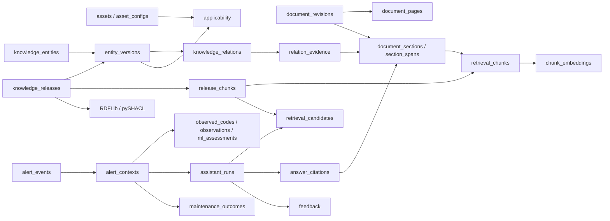

# RSW 정비 안내 MVP — PostgreSQL 전체 스키마

작성일: 2026-09-26 · 설계안 v1 · 대상: PostgreSQL 18 + pgvector 0.8 이상

이 문서는 **장비 경보를 받아 관련 근거와 정비 안내를 작업자에게 제시하는 MVP**의 데이터 계약이다. 실행 가능한 초기 DDL은 [schema.sql](schema.sql)에 있다. 현재 운영 DB에 적용한 결과가 아니라, 구현을 시작하기 위한 설계와 마이그레이션 초안이다.

## 1. 설계 결론

**PostgreSQL을 원본 텍스트·검토된 지식·검색 데이터·실행 이력의 기준 저장소로 사용한다. RDFLib은 특정 지식 버전의 RDF를 생성·조회하고, pySHACL은 그 RDF의 구조를 검사한다.**

DB에는 개념을 식별하는 행, 버전별 개념 정의, 관계, 관계의 근거, 장비 적용성을 구조화해 보관한다. RDF를 만들기 전부터 지식의 구조가 PostgreSQL에 존재한다. RDFLib은 그 데이터를 RDF 표현으로 변환하는 역할을 하며, 필요한 추론 규칙은 별도로 명시해야 한다. pySHACL을 실행했다고 물리적 고장 원인이 검증되는 것은 아니다.

총 **43개 테이블**이다. 한 기능당 무조건 한 테이블을 만든 것이 아니라, 다대다 관계·원문 위치·지식 버전·검토와 실행 이력을 구분한 결과다. 저장할 초기 데이터는 장비 1대, 시나리오 10개로 작게 시작한다. 아래 SQL은 장비 관련 사실이나 검증되지 않은 매뉴얼 적용성을 초기값으로 넣지 않는다.

| 영역 | 테이블 수 | 저장하는 내용 |
|---|---:|---|
| 식별자·장비 | 4 | 사람/서비스, 개념 ID, 장비, 장비 구성 버전 |
| 원문과 위치 | 4 | 문서 판본, 페이지, 절, 인용 위치 |
| 버전별 지식 | 16 | 배포본, 개념 정의, 관계, 절차, 수치, 근거, 적용성, 충돌 |
| 검색·활성 버전 | 5 | 청크, 임베딩 모델/벡터, 배포본별 검색 목록, 활성 배포본 |
| ML 경보 입력 | 6 | 송신자, 원본 이벤트, 정규화 결과, 코드, 관측값, ML 판단 |
| 답변·검토·정비 결과 | 5 | 실행, 검색 후보, 인용, 피드백, 실제 확인 결과 |
| 평가 | 3 | 고정된 평가 사례, 정답 근거, 평가 결과 |

### 무엇을 어디에 저장하는가

| 데이터 | 기준 위치 | 설명 |
|---|---|---|
| PDF/DOCX 원본 파일 | 파일 저장소 + `document_revisions.source_uri/source_sha256` | v1은 원본 파일 바이너리를 DB에 중복 저장하지 않는다. 로컬 파일 저장소도 가능하지만 수정 불가 경로와 백업이 필요하다. |
| 원문의 추출 텍스트·표에서 추출한 텍스트 | PostgreSQL | `document_pages`, `document_sections`, `section_spans`. 원본 파일을 대체하는 것은 아니다. |
| ML에서 받은 JSON의 원래 바이트 | PostgreSQL | `alert_events.raw_payload`의 `bytea`. 검색·정규화용 `parsed_payload`와 함께 저장한다. |
| 개념·관계·절차·근거·적용성 | PostgreSQL | 특정 `release_id`에 속한 검토 가능한 행으로 저장한다. |
| 검색 청크와 벡터 | PostgreSQL + pgvector | 임베딩 모델과 차원을 함께 추적한다. |
| 온톨로지 TBox·SHACL shape·매핑 코드 | 버전 관리 저장소 | URI 규칙, 클래스/속성, 제약, 빌더 코드를 관리한다. DB에는 버전과 해시를 기록한다. |
| 생성된 RDF 스냅샷 | 파일 저장소 + `knowledge_releases.graph_uri/graph_sha256` | PostgreSQL의 동결된 지식 배포본에서 재생성한다. |
| 고주파 센서 시계열 | 별도 파일/시계열 저장소 | MVP에서는 윈도 요약과 `observations.raw_series_ref`만 저장한다. |

원본 PDF까지 반드시 PostgreSQL 내부에 보관해야 한다면 별도의 파일 테이블에 `bytea`를 넣는 확장이 가능하다. 현재 DDL은 **원문 텍스트와 원본 파일의 위치·해시를 DB에 저장하는 방식**으로 정했다.

## 2. 핵심 연결 관계

다음은 전체 96개 외래키 중 주된 데이터 흐름만 나타낸 그림이다. 모든 세부 연결은 뒤의 데이터 사전과 SQL에 있다.



### ID와 버전 규칙

- `id`: UUID. 표시 이름이나 경보 문자열을 PK로 사용하지 않는다.
- `knowledge_entities`: 개념의 지속적인 ID와 종류, 네임스페이스, 원래 코드를 가진다. 이름과 설명은 여기에 넣지 않는다.
- `entity_versions`: `(release_id, entity_id)`가 PK다. 같은 개념의 설명·검토 상태가 지식 버전에 따라 달라질 수 있다.
- 원문 절은 추출 버전에 종속된 개념이다. 문서 개정 또는 재추출로 절 내용이 바뀌면 새 `document_revision`과 새 절 ID를 만든다.
- `asset_configs`: 장비 제조사·모델·제어기 등의 구성 스냅샷. 구성이 바뀌거나 미확인 사항을 확인하면 새 revision을 만든다.
- `knowledge_releases`: 응답에 사용한 지식 전체의 버전. 이전 답변은 당시 버전을 계속 참조한다.
- 별도 언급이 없는 연결은 `ON DELETE CASCADE`를 사용하지 않는다. 원문·과거 근거를 삭제하면서 이력이 사라지는 흐름을 허용하지 않는다.

**코드 문자열이 같다고 같은 개념이 아니다.** 예를 들어 논문의 고장 분류, 원시 데이터 경보 코드, Festo 제어기 경보는 서로 다른 namespace로 만든다. `namespace`에는 데이터셋/장비 제품군/해당 코드 체계 버전을 구분할 수 있는 안정된 값을 사용한다. 서로 의미가 같다는 매핑도 `knowledge_relations`와 검토된 근거로 따로 표현한다.

`fault_type`, `alarm_code`, `hypothesis`, `diagnostic_rule`, `component_type`은 `knowledge_entities.kind`와 `entity_versions`로 표현한다. 추가 속성이 없는 이 종류들을 위해 동일한 컬럼의 빈 하위 테이블을 반복해서 만들지 않았다. 시나리오·센서 정의·패턴·절차·수치에는 전용 하위 테이블을 둔다.

## 3. 이 도메인에서 반드시 구분할 것

| 구분 | 저장 방법 | 해석 |
|---|---|---|
| 고장 분류 / 원인 후보 / 확정 결과 | `fault_type` / `hypothesis` / `maintenance_outcomes` | ML 분류를 물리적 원인 확정으로 바꾸지 않는다. |
| 일반 원리 / 실제 장비에 적용할 절차 | `applicability.reference_scope` | `analogous`, `comparison`, `unknown`을 `applicable`로 취급하지 않는다. |
| 논문 정의 / 장비 설정 / 정비 한계 | `numeric_specs.spec_kind` | 같은 단위의 수치라도 용도가 다르면 대체하지 않는다. |
| 관측값 / ML 판단 / 사람 검토 | `observations` / `ml_assessments` / `feedback` | 생성 경로와 권한이 다른 데이터를 분리한다. |
| 답변의 적절성 / 실제 수리로 확인한 사실 | `feedback` / `maintenance_outcomes` | 작업자의 좋은 평가만으로 원인 관계를 확정하지 않는다. |
| 적용 조건 미충족 / 조건 정보 부족 | 조건 평가 결과 `false` / `unknown` | 모르는 조건을 충족으로 간주하지 않는다. |

Festo 자료가 논문 장비와 유사하다는 이유만으로 `reference_scope='applicable'`을 넣으면 안 된다. 실제 장비와 제어기를 확인하고 팀원의 근거 검토를 통과해야 한다. 그 전에도 `analogous` 자료를 이용한 **참고용 설명과 추가 확인 질문**은 구현할 수 있다.

`README 5.10`의 실제 내용과 ML JSON 샘플이 확정되지 않은 상태이므로, 아래 경보 관련 스키마는 수신 원본을 보존하면서 정규화를 별도 버전으로 남기도록 설계했다. 미확인 센서 태그를 임의로 특정 물리량으로 확정하지 않는다.

## 4. 저장·배포·응답 순서

### 4.1 원문 등록

1. `document_revisions`를 `sealed_at=NULL`로 생성한다.
2. 페이지, 절, span을 넣는다. 절의 `knowledge_entities` ID를 먼저 생성한다.
3. 추출 텍스트와 위치를 검사한다. PDF는 실제 파일의 1부터 시작하는 페이지 번호와 인쇄 페이지 표기를 구분한다. DOCX/웹 등은 `logical_block`을 사용하고 PDF 페이지인 것처럼 표시하지 않는다.
4. `sealed_at=now()`로 원문 판본 전체를 봉인한다. 이후 해당 판본 아래에 페이지·절·span 추가도 금지한다. 수정은 새 추출 revision으로 등록한다.

텍스트 offset은 **해당 페이지 추출 문자열의 Unicode code point 기준, 0부터 시작하는 `[char_start, char_end)`**로 정한다. bbox는 `[x0,y0,x1,y1]`, 좌상단 원점의 0~1 정규화 좌표를 권장한다. SQL은 배열 타입만 확인하므로 길이·범위는 추출 서비스가 검사한다.

### 4.2 검토된 지식 배포

1. `knowledge_releases(status='draft')`를 만든다. 이전 버전에서 시작하면 관련 자식 행을 새 release로 복사한다. `parent_release_id` 자체가 자동 복사를 수행하지는 않는다.
2. 개념 버전, 관계, 절차, 근거, 적용성, 충돌, `release_chunks`를 작성한다. 모든 수정은 같은 release 부모 행을 먼저 잠그는 트랜잭션으로 처리한다.
3. 도메인 담당자가 내용과 적용성을 검토한다. 최종 전체 검토 후 `domain_reviewed_by/at`를 기록한다. 이후 내용 또는 의미 있는 배포 메타데이터를 바꾸면 최종 승인이 해제된다.
4. `status='frozen'`으로 동결한다. 포함된 모든 원문 판본은 봉인 상태여야 한다. 이후 지식 행과 의미 관련 메타데이터는 수정할 수 없다.
5. 정확히 이 release에서 RDF를 생성하고 pySHACL 및 아래의 배포 검사를 실행한다. 실패하면 보고서를 남기고 수정된 새 draft를 만든다. 동결 해제는 하지 않는다.
6. 실제 결과를 `validation_report`, `shacl_conforms`, `publish_checks_passed`, RDF URI/해시에 기록하고 `published`로 전환한다.
7. `knowledge_deployments`의 예를 들어 `pilot` 행을 새 release로 변경한다. 비활성화는 `release_id=NULL`로 한다. 기존 실행은 이전 release를 유지한다.

DB에 `shacl_conforms=true`를 기록하는 것만으로 SHACL 검사가 실행되는 것은 아니다. **검사를 실행하고 결과를 기록하는 배포 서비스와 쓰기 권한 분리가 필요하다.** 이 DDL은 DB 사용자/권한 정책을 생성하지 않는다. DDL 소유자나 superuser가 제약을 우회하지 못하도록 막는 설계도 아니다.

### 4.3 경보 수신과 답변

1. `alert_events`에 송신자·이벤트 ID·원본 바이트·파싱된 객체·해시를 보관한다. 동일 `(producer_id, source_event_id)` 재수신은 기존 해시를 확인한다. 같은 ID에 다른 payload가 오면 덮어쓰지 말고 수신 충돌로 기록/처리한다.
2. 활성 release와 장비 구성 ID를 고정하여 `alert_contexts`를 만든다. 코드·센서·ML 결과를 자식 테이블에 넣고 context를 봉인한다. 원문을 다시 해석할 때는 새 `normalizer_version`의 새 context를 만든다.
3. 봉인 context에 `assistant_runs(status='pending')`를 만든다. 질문, 모델, 프롬프트 버전, 검색기 버전, 임베딩 모델을 처음부터 고정한다.
4. 코드/그래프/키워드/벡터로 후보를 모으고 적용성·조건·충돌을 확인한다. `retrieval_candidates`에 각 단계가 확정된 결과를 INSERT한다. 저장된 후보를 나중에 UPDATE하는 구조가 아니다. 최종 `fusion` 또는 `rerank` 행의 `selected=true`로 선택 결과를 남긴다.
5. LLM에 실제 전달한 시스템/사용자 메시지, 근거 텍스트와 ID, 조건 평가, 모델 설정을 `input_snapshot`에 보관한다. 정규화 이벤트만 복사해 두는 것으로 대체하지 않는다.
6. 답변의 근거 span을 인용 행에 넣고 답변을 확정한다. `answered`, `needs_context`, `insufficient_evidence`, `failed` 중 하나로 완료하면 실행과 하위 검색/인용 기록이 고정된다.
7. 사람 피드백과 실제 정비 확인 결과를 별도 추가한다. 정정은 `supersedes_id`로 같은 실행/같은 context의 이전 기록을 가리키는 새 행이다.

입력 데이터가 원래 JSON 객체가 아닌 손상된 메시지인 경우 이 스키마의 `alert_events.parsed_payload`에 넣을 수 없다. 전송 수신기의 실패 큐/로그에서 처리한다. 수신 가능한 JSON 객체지만 내용이 잘못된 경우에는 `alert_contexts.status='invalid'` 등으로 보존한다.

MVP는 **경보와 연결된 질의응답**을 기준으로 하므로 `assistant_runs.context_id`가 필수다. 경보 없이 장비 매뉴얼을 자유롭게 질문하는 기능은 현재 범위에 포함하지 않았고, 추가 시 별도 대화 context 모델로 확장한다.

### 4.4 평가

도메인 담당자가 **published 지식 버전**을 대상으로 `evaluation_cases`와 정답 근거를 작성한 후 case를 봉인한다. 사례 본문도 수정이 필요하면 새 revision으로 만든다. `evaluation_results`는 봉인된 사례와 완료된 실행에 대해서만 기록한다. 배포 전 SHACL/도메인 검사는 이 사후 답변 평가와 별도이며, 답변 평가에 실패한 새 버전은 활성 포인터로 지정하지 않는다.

`requirement_group`은 정답 근거의 대안 묶음이다. **한 그룹 안에서는 하나 이상의 근거를 충족하면 되고, 모든 그룹을 충족해야 한다**는 규칙을 평가기에 구현한다. 두 근거가 모두 필요하면 서로 다른 그룹에 넣는다. `relevance_grade`는 1~3의 관련도 등급이다. 이 의미와 계산식은 `evaluator_version`으로 관리하며 DB가 Recall 등의 지표를 자동 계산하지 않는다.

10개 시나리오마다 정상 정답 외에 코드 미매핑, 조건 누락, 유사 장비 매뉴얼만 존재, 근거 충돌을 포함한다. 개발용 예시와 holdout을 분리하고, 동일 경보의 질문 표현만 바꾼 사례는 같은 그룹으로 분할해 누출을 줄인다. `evaluation_results` 작성 서비스는 실제 run 입력이 평가 사례 입력과 일치하는지 확인한다.

## 5. PostgreSQL / SHACL / 서비스 검증의 경계

| 항목 | DDL이 보장하는 범위 | 추가로 구현할 검증 |
|---|---|---|
| 관계 양 끝의 개념 종류 | 복합 FK와 `relation_rules` | 해당 관계의 사실성, 조건, 근거의 충분성 |
| 원문 판본·페이지·절 연결 | FK로 같은 판본 참조 | 페이지 수 범위, offset/좌표, 실제 인용문 일치, 청크가 실제 절 내용을 포함하는지 |
| 지식 버전 | release 동결 후 변경 금지 | 필수 하위 타입 존재, 승인된 내용만 포함, 명시적 conflict 처리 |
| 장비 적용성 | 대상 장비 구성과 검토 상태 기록 | 실장비 일치, firmware/부품 조건, 상충하는 적용성 행, `unknown` 조건 처리 |
| 수치 | 타입·유한값·범위 관계 | 단위 의미, 논문 정의와 장비 정비 한계 구분, 조건식 평가 |
| 벡터 | 모델-차원 FK, 실제 벡터 차원 CHECK | 같은 모델의 질의 벡터, 적절한 거리 함수, 영벡터 등 비정상 입력, 모델별 검색 |
| 답변 이력 | release/context 참조, 완료 후 기록 변경 금지 | 전달 메시지 전체 snapshot, 인용문 원문 일치, 근거 없는 단정 차단 |
| RDF | 버전·해시·검사 결과 저장 | RDFLib 빌드, pySHACL 실행, 필요 시 별도 추론 규칙 실행 |
| 평가 | case/run의 release 일치, case 봉인 | 입력 일치, 그룹별 근거 충족, 평가자 독립성, 지표 계산 |

배포 검사 최소 항목:

1. 대상 release의 런타임 노출 엔티티·관계·적용성은 검토 완료여야 한다. 후보/미확인 지식은 명확한 상태로만 노출하고 절차 실행 안내에 승격하지 않는다.
2. subtype이 필요한 entity에는 정확한 subtype 행이 있어야 한다. 문서 절과 청크는 실제 추출 원문으로 추적 가능해야 한다.
3. 근거를 요구하는 관계·적용성은 충분한 `relation_evidence`/`applicability_evidence`를 가져야 한다. 근거 문서의 종류와 신뢰도를 함께 검토한다.
4. 실제 안내 대상 절차와 그 단계·수치가 모두 해당 장비 구성/부품/운전 조건에 적합해야 한다. 절차에 적용성 행 하나가 있다고 모든 단계가 자동으로 적합해지는 것은 아니다.
5. unresolved conflict가 있는 내용으로 단일 확정값·확정원인을 생성하지 않는다. 검토자가 충돌을 해결하거나, 추가 확인/근거 부족 응답으로 제한한다.
6. 센서 feature와 원시 태그의 단위·변환·기준선·윈도 정의를 검사한다. 논문의 ML 점수를 교정된 확률로 오해하지 않는다.
7. SHA-256 형식만 SQL이 검사한다. 파일/텍스트/원본 payload의 실제 해시 계산과 일치는 수집 서비스가 검증한다.

## 6. JSONB 사용 계약

주요 개념·관계·키·상태는 정규화된 컬럼이다. 공급자별 ML 부가정보, 아직 안정되지 않은 조건식, 응답 snapshot처럼 구조가 바뀌는 부분만 JSONB로 둔다. `object_json`과 `array_json`은 최상위 타입만 제한한다. 내부 필드는 Pydantic/JSON Schema로 버전 검증한다.

권장 계약:

| 컬럼 계열 | 담을 내용 | 금지/주의 |
|---|---|---|
| `conditions` | 허용된 field/operator/value로 된 조건식 | 임의 Python/SQL 문자열 실행 금지; 모르는 필드/연산은 오류 또는 `unknown` |
| `conversion` | 승인된 단위 변환 ID 또는 scale/offset | 자유 형식 실행 코드를 넣지 않는다. |
| `baseline_definition`, `window_definition` | 비교 대상, 시간 범위, 집계 방식 | 기준선과 윈도를 생략한 임계치 비교를 확정 판단에 사용하지 않는다. |
| `required_context`, `required_questions` | 필요한 정보 또는 질문 목록 | 질문 생성에 필요한 필드 키와 사용자 표현을 함께 관리한다. |
| `applicability_result` | scope, 조건 평가, 승인 행 ID, 허용/제외 이유 | 검색 점수가 높다는 이유로 적용성 미확인을 통과시키지 않는다. |
| `answer` | 응답 상태, 근거 있는 설명, 추가 질문, 검토된 안내, 인용 claim key | 실행과 자동 장비 제어를 혼동하지 않는다. |
| `input_snapshot` | 실제 LLM 메시지·근거·정규화 입력·사용 설정 | 외부 모델의 비결정성 때문에 동일 출력을 보장하는 것은 아니다. |
| `validation_report` | 도구/계약 버전, 수행 시점, SHACL 결과, 도메인 검사별 결과 | 단순 `{"ok":true}`만으로 검증 이력을 대체하지 않는다. |

조건식의 출발 예시(실제 현장 규칙이 아닌 스키마 예시):

```json
{"all": [{"field": "operating_context.cycle_state", "op": "eq", "value": "welding"}]}
```

`{}`가 의미하는 바를 계약에 명시해야 한다. 조건이 없는 경우와 아직 조건을 작성하지 못한 경우를 같은 값으로 처리하지 않으며, 후자는 `review_status`/검증 상태로 차단한다. 조건 문법은 `validation_contract_version`과 코드로 고정하고 필드/단위/연산자별 테스트를 둔다.

## 7. 검색 구성과 인덱스

검색 순서: **정확한 코드/네임스페이스 매칭 → 해당 지식 관계와 원문 절 → 키워드·벡터 후보 확장 → 적용성·조건 검사 → 결합/재정렬 → 인용 가능한 근거로 응답**.

벡터는 사용자의 표현과 매뉴얼 표현이 다른 경우를 보완한다. 경보 코드, 수치, 장비 적용 여부를 벡터 점수로 결정하지 않는다. 실제 절차 답변 후보는 `applicable + reviewed + 조건 충족`으로 제한한다. `analogous` 자료는 참고 설명용 검색 결과로 별도 표시하고 적용 절차 후보와 섞지 않는다.

- B-tree: 코드/별칭, release별 관계, 장비 구성별 적용성, 이벤트/실행 시간.
- GIN: `retrieval_chunks.search_tsv`. `simple` 설정의 기본 전문 검색이며 **한국어 형태소 분석이나 BM25가 아니다.** 초기에는 검토된 별칭·검색어를 `search_terms`에 넣고 벡터 결과와 결합한다.
- 벡터: MVP는 **exact search**. HNSW/IVFFlat은 만들지 않았다. 청크 수와 실제 지연 시간을 측정한 뒤 도입한다.
- `embedding`은 차원을 고정하지 않은 `vector`이고 모델별 dimensions FK와 `vector_dims()` CHECK로 검증한다. 같은 차원의 다른 모델도 혼용하면 안 된다.
- 추후 ANN을 쓰면 모델/차원별 고정 차원 표현식 인덱스 또는 분할 구조를 검토한다. 필터 후 후보 부족과 recall도 다시 평가한다.

코사인 검색 예시(애플리케이션의 바인딩 파라미터 사용):

```sql
-- $1: release UUID, $2: embedding model UUID
-- $3: 서비스가 적용성/조건/충돌 검사를 통과시킨 chunk UUID 배열
-- $4: 같은 모델로 만든 query vector, $5: top-k
-- 호출 전에 모델의 distance_metric='cosine'과 질의 차원을 검증한다.
WITH eligible AS MATERIALIZED (
    SELECT c.id, c.section_id, c.content, ce.embedding
    FROM rsw.release_chunks rc
    JOIN rsw.retrieval_chunks c ON c.id = rc.chunk_id
    JOIN rsw.chunk_embeddings ce ON ce.chunk_id = c.id
    WHERE rc.release_id = $1
      AND ce.embedding_model_id = $2
      AND c.id = ANY($3::uuid[])
)
SELECT id, section_id, content, embedding <=> $4::public.vector AS distance
FROM eligible
ORDER BY distance, id
LIMIT $5;
```

이 SQL만으로 적용성 조건을 자동 평가하지 않는다. `$3`는 서비스가 판정한 결과이고, 임의의 모든 청크 ID를 넣으면 해당 제약의 의미가 사라진다. 조회 연결은 `public`을 포함한 search_path로 벡터 연산자를 해석하도록 설정한다.

RDF에서는 entity UUID로 안정된 IRI를 만든다. 조건·근거·검토 상태가 있는 관계는 관계 자체에 IRI를 주는 재구체화/관계 노드 또는 명명 그래프로 표현한다. `subject–predicate–object` 한 줄만 남기면서 조건을 버리면 안 된다. `maps_to`를 `owl:sameAs`로 자동 변환하지 않는다. 추론 결과는 명시한 사실과 구분하고 사용한 규칙 버전과 근거를 남긴다.

## 8. 개발 적용과 검증 상태

순서:

1. 개발용 PostgreSQL 18 인스턴스에 호환되는 pgvector를 설치하고 실제 사용 버전을 고정한다.
2. 비어 있는 `rsw` 스키마를 대상으로 `schema.sql`을 초기 마이그레이션으로 적용한다. 이미 존재하면 실패하는 설계다. 기존 DB의 데이터를 변경하는 범용 업그레이드 스크립트가 아니다.
3. Alembic 등에서 이 초기 버전을 관리하고, 이후 변경은 후속 마이그레이션으로 추가한다. API용 DB 계정과 수집/검토/배포 권한은 별도로 구성한다.
4. 도메인 데이터 수집·봉인, 지식 검토·배포, ML 정규화, 검색·응답, 평가 순으로 구현한다. 설정 화면을 모두 먼저 만들 필요 없이 초기에는 검증된 적재 스크립트를 사용해도 된다.
5. 아래 DB 실행 검증과 제약 테스트를 완료한 뒤 실제 데이터를 적재한다.

검증 상태:

- 완료: 정적 구조 검사에서 **43개 테이블, 392개 컬럼, 96개 FK**를 확인했다. 참조 컬럼 존재, 복합 FK의 UNIQUE 대상, 기본 타입 일치, PK 존재, 동적 트리거 대상 테이블 이름을 검사했다.
- 완료: 별도의 정적 검토로 봉인·배포·실행 완료 흐름과 복합 FK를 점검했다.
- **미실행:** 현재 환경에 PostgreSQL/pgvector 실행 도구가 없어 실제 DDL 실행, PL/pgSQL 트리거 동작, 동시 쓰기, 잠금/교착상태, 검색 실행 계획·성능은 검증하지 못했다. 정적 검사는 PostgreSQL 문법 검사기를 대신하지 않는다.
- [checks.sql](checks.sql)은 실제 DB에서 실행할 30개 단일 세션 제약 검사 스크립트다. 제공 시점에는 이 스크립트 역시 실행 검증 전이다.

개발 DB에서 실행할 예시:

```bash
psql "$RSW_DATABASE_URL" -v ON_ERROR_STOP=1 -f schema.sql
psql "$RSW_DATABASE_URL" -v ON_ERROR_STOP=1 -f checks.sql
```

`schema.sql`은 BEGIN/COMMIT으로 스키마를 설치한다. `checks.sql`은 BEGIN/ROLLBACK으로 시험 데이터를 되돌린다. 빈 개발 DB에서 먼저 실행한다. 서비스는 트랜잭션 시작 시 부모 release/context/run을 먼저 잠그고 자식 행을 일정한 순서로 기록하며, deadlock/serialization 실패는 제한된 횟수로 재시도해야 한다.

DDL에는 보존/삭제 정책, 조직별 격리, 외부 인증, 자동 장비 제어, 전체 시계열 저장을 포함하지 않았다. 현재 사용 사례의 경보 기반 근거 안내에 필요한 구조를 정의한다.

## 9. 공식 기술 근거

- [PostgreSQL 제약조건](https://www.postgresql.org/docs/18/ddl-constraints.html): PK, UNIQUE, FK, CHECK와 NULL의 동작. 다른 행/테이블과 관련된 업무 검증을 CHECK 하나로 대신하지 않는다.
- [PostgreSQL JSON 타입](https://www.postgresql.org/docs/18/datatype-json.html): JSONB는 공백·키 순서·중복 키를 원형 그대로 보존하지 않으므로 원본 payload bytea를 별도로 저장한다.
- [PostgreSQL 잠금](https://www.postgresql.org/docs/18/explicit-locking.html): 부모 행 잠금을 사용한 직렬화와 교착상태 재시도 고려.
- [pgvector 공식 저장소](https://github.com/pgvector/pgvector): exact/approximate 검색, 벡터 차원과 거리 연산자, 필터 조건의 영향.

## 10. 전체 데이터 사전

아래는 DDL에서 추출한 **모든 테이블과 모든 컬럼**이다. `필수`는 NOT NULL 또는 PK, `선택`은 SQL NULL 허용, `자동 계산`은 generated column이다. DEFAULT가 있어도 명시적 NULL은 허용하지 않는 필드가 있으므로 구분한다. 컬럼 정의에는 타입·기본값·단일 컬럼 CHECK/FK를 그대로 담고, 복합 키와 테이블 CHECK는 각 표 아래에 수록했다.

공통 의미: `release_id`는 지식 버전, `entity_id`는 지속적인 개념 ID, `context_id`는 봉인된 경보 해석 단위, `run_id`는 한 번의 답변 실행이다. 시간은 `timestamptz`로 저장하고 표시에만 한국 시간 등을 적용한다. NULL은 0/false/빈 문자열과 다르며, 미확인 값은 임의의 기본값으로 대체하지 않는다.


### 10.1 식별자·장비


#### 01. `actors`

작성자·도메인 검토자·작업자·서비스의 식별자. 로그인 비밀번호를 저장하는 인증 테이블이 아니다.

| 컬럼 | 타입 | 입력 | 기본값 | 의미 |
|---|---|---|---|---|
| `id` | `uuid` | 필수 | `gen_random_uuid()` | 행 또는 엔티티의 UUID |
| `external_key` | `text` | 필수 | — | 외부 사용자/서비스의 고유 식별자 |
| `display_name` | `text` | 필수 | — | 표시 이름 |
| `role` | `text` | 필수 | — | 사용자/서비스의 역할 구분 |
| `active` | `boolean` | 필수 | `true` | 활성 여부 |
| `created_at` | `timestamptz` | 필수 | `now()` | 최초 등록 시각 |

키·검사 제약(해당 테이블의 세부 정의):

```sql
id uuid PRIMARY KEY DEFAULT gen_random_uuid()
external_key text NOT NULL UNIQUE
role text NOT NULL CHECK (role IN ('developer','domain_reviewer','operator','service'))
```

#### 02. `knowledge_entities`

변하지 않는 개념 ID 사전. 종류와 namespace와 local_code의 조합이 유일하다.

| 컬럼 | 타입 | 입력 | 기본값 | 의미 |
|---|---|---|---|---|
| `id` | `uuid` | 필수 | `gen_random_uuid()` | 행 또는 엔티티의 UUID |
| `kind` | `text` | 필수 | — | 개념 종류 |
| `namespace` | `text` | 필수 | — | 출처와 코드 체계의 구분자 |
| `local_code` | `text` | 필수 | — | 해당 namespace 안의 코드 |
| `created_at` | `timestamptz` | 필수 | `now()` | 최초 등록 시각 |

키·검사 제약(해당 테이블의 세부 정의):

```sql
id uuid PRIMARY KEY DEFAULT gen_random_uuid()
kind text NOT NULL CHECK (kind IN ('component_type','scenario','fault_type','alarm_code','diagnostic_rule','hypothesis','evidence_pattern','feature','document_section','procedure','numeric_spec'))
namespace text NOT NULL CHECK (length(namespace) > 0)
local_code text NOT NULL CHECK (length(local_code) > 0)
UNIQUE (kind, namespace, local_code)
UNIQUE (id, kind)
```

#### 03. `assets`

실제 장비의 고정 식별자. 제조사·제어기 등 판단에 영향을 주는 정보는 구성 버전에 둔다.

| 컬럼 | 타입 | 입력 | 기본값 | 의미 |
|---|---|---|---|---|
| `id` | `uuid` | 필수 | `gen_random_uuid()` | 행 또는 엔티티의 UUID |
| `asset_code` | `text` | 필수 | — | 현장 장비 식별 코드 |
| `display_name` | `text` | 필수 | — | 표시 이름 |
| `location` | `text` | 선택 | — | 설치 위치 표시 |
| `created_at` | `timestamptz` | 필수 | `now()` | 최초 등록 시각 |

키·검사 제약(해당 테이블의 세부 정의):

```sql
id uuid PRIMARY KEY DEFAULT gen_random_uuid()
asset_code text NOT NULL UNIQUE
```

#### 04. `asset_configs`

장비 구성의 불변 스냅샷. 미확인 모델이나 firmware를 추정해서 채우지 않는다.

| 컬럼 | 타입 | 입력 | 기본값 | 의미 |
|---|---|---|---|---|
| `id` | `uuid` | 필수 | `gen_random_uuid()` | 행 또는 엔티티의 UUID |
| `asset_id` | `uuid` | 필수 | — | 실제 장비 UUID |
| `revision` | `integer` | 필수 | — | 1부터 증가하는 개정 번호 |
| `manufacturer` | `text` | 선택 | — | 장비 제조사 |
| `model` | `text` | 선택 | — | 장비 모델 |
| `controller_manufacturer` | `text` | 선택 | — | 제어기 제조사 |
| `controller_model` | `text` | 선택 | — | 제어기 모델 |
| `controller_firmware` | `text` | 선택 | — | 제어기 firmware 버전; 미확인은 NULL |
| `drive_type` | `text` | 필수 | — | 서보 공압/공압/서보 전동/미확인 구분 |
| `components` | `object_json` | 필수 | `'{}'::jsonb` | 구성 부품 식별 정보 |
| `verification_status` | `text` | 필수 | `'unverified'` | 확인 여부 |
| `verified_by` | `uuid` | 선택 | — | 확인 담당 actor |
| `verified_at` | `timestamptz` | 선택 | — | 확인한 시각 |
| `verification_basis` | `text` | 선택 | — | 확인에 사용한 근거 |
| `effective_from` | `timestamptz` | 필수 | — | 구성 유효 시작; 이벤트 시점의 구성 선택은 서비스가 검증 |
| `created_at` | `timestamptz` | 필수 | `now()` | 최초 등록 시각 |

키·검사 제약(해당 테이블의 세부 정의):

```sql
id uuid PRIMARY KEY DEFAULT gen_random_uuid()
asset_id uuid NOT NULL REFERENCES assets(id)
revision integer NOT NULL CHECK (revision > 0)
drive_type text NOT NULL CHECK (drive_type IN ('servo_pneumatic','pneumatic','servo_electric','unknown'))
verification_status text NOT NULL DEFAULT 'unverified' CHECK (verification_status IN ('unverified','verified'))
verified_by uuid REFERENCES actors(id)
UNIQUE (asset_id, revision)
UNIQUE (id, asset_id)
CHECK (verification_status <> 'verified' OR (manufacturer IS NOT NULL AND model IS NOT NULL AND controller_model IS NOT NULL AND verified_by IS NOT NULL AND verified_at IS NOT NULL AND verification_basis IS NOT NULL AND drive_type <> 'unknown'))
```

### 10.2 원문과 위치


#### 05. `document_revisions`

문서의 판본 및 추출 버전. 파일 위치·해시와 봉인 상태를 함께 보관한다.

| 컬럼 | 타입 | 입력 | 기본값 | 의미 |
|---|---|---|---|---|
| `id` | `uuid` | 필수 | `gen_random_uuid()` | 행 또는 엔티티의 UUID |
| `document_key` | `text` | 필수 | — | 같은 문서 계열을 식별하는 키 |
| `revision_key` | `text` | 필수 | — | 문서 판본을 식별하는 키 |
| `source_kind` | `text` | 필수 | — | 매뉴얼/논문/팀 분석/현장 절차 등 원문 종류 |
| `title` | `text` | 필수 | — | 문서 또는 절 제목 |
| `publisher` | `text` | 선택 | — | 발행 기관 |
| `edition_label` | `text` | 선택 | — | 원문에 표시된 판본/개정 표기 |
| `language` | `text` | 필수 | — | 언어 코드 |
| `source_uri` | `text` | 필수 | — | 원본 파일의 불변 저장 위치 |
| `source_sha256` | `sha256_hex` | 필수 | — | 원본 파일 SHA-256 |
| `extraction_version` | `text` | 필수 | — | 텍스트 추출기와 설정 버전 |
| `page_count` | `integer` | 선택 | — | 판본의 페이지/논리 블록 총수 |
| `sealed_at` | `timestamptz` | 선택 | — | 부모와 하위 데이터 확정 시각; 이후 추가·수정 금지 |
| `created_by` | `uuid` | 선택 | — | 등록한 actor |
| `created_at` | `timestamptz` | 필수 | `now()` | 최초 등록 시각 |

키·검사 제약(해당 테이블의 세부 정의):

```sql
id uuid PRIMARY KEY DEFAULT gen_random_uuid()
source_kind text NOT NULL CHECK (source_kind IN ('manual','paper','team_analysis','expert_note','site_procedure','maintenance_record'))
page_count integer CHECK (page_count > 0)
created_by uuid REFERENCES actors(id)
UNIQUE (document_key, revision_key, extraction_version)
```

#### 06. `document_pages`

판본별 실제 PDF 페이지 또는 논리 블록의 텍스트. 인쇄된 페이지 표기는 별도 문자열이다.

| 컬럼 | 타입 | 입력 | 기본값 | 의미 |
|---|---|---|---|---|
| `document_revision_id` | `uuid` | 필수 | — | 문서 판본/추출 revision UUID |
| `page_number` | `integer` | 필수 | — | 1부터 시작하는 실제 페이지 또는 논리 블록 번호 |
| `locator_kind` | `text` | 필수 | `'pdf_page'` | PDF 페이지/논리 블록 구분 |
| `printed_page_label` | `text` | 선택 | — | 원문 인쇄 페이지 표기; 로마자 등도 허용 |
| `page_text` | `text` | 필수 | — | 추출된 페이지 전체 텍스트 |
| `text_sha256` | `sha256_hex` | 필수 | — | 정해진 인코딩의 텍스트 SHA-256 |
| `extraction_method` | `text` | 필수 | — | native/OCR/수동/HTML 추출 구분 |

키·검사 제약(해당 테이블의 세부 정의):

```sql
document_revision_id uuid NOT NULL REFERENCES document_revisions(id)
page_number integer NOT NULL CHECK (page_number > 0)
locator_kind text NOT NULL DEFAULT 'pdf_page' CHECK (locator_kind IN ('pdf_page','logical_block'))
extraction_method text NOT NULL CHECK (extraction_method IN ('native','ocr','manual','html'))
PRIMARY KEY (document_revision_id, page_number)
```

#### 07. `document_sections`

의미 있는 절·항목·표 단위 원문. RDF에서 인용 가능한 개념으로도 식별한다.

| 컬럼 | 타입 | 입력 | 기본값 | 의미 |
|---|---|---|---|---|
| `id` | `uuid` | 필수 | — | 행 또는 엔티티의 UUID |
| `entity_kind` | `text` | 필수 | `'document_section'` | 개념 종류; 타입 일치 FK에 사용 |
| `document_revision_id` | `uuid` | 필수 | — | 문서 판본/추출 revision UUID |
| `section_key` | `text` | 필수 | — | 판본 안에서 유일한 절 식별자 |
| `section_number` | `text` | 선택 | — | 원문 절 번호 표기 |
| `title` | `text` | 필수 | — | 문서 또는 절 제목 |
| `original_text` | `text` | 필수 | — | 절의 추출 원문 텍스트 |
| `text_sha256` | `sha256_hex` | 필수 | — | 정해진 인코딩의 텍스트 SHA-256 |

키·검사 제약(해당 테이블의 세부 정의):

```sql
id uuid PRIMARY KEY
entity_kind text NOT NULL DEFAULT 'document_section' CHECK (entity_kind = 'document_section')
document_revision_id uuid NOT NULL REFERENCES document_revisions(id)
FOREIGN KEY (id, entity_kind) REFERENCES knowledge_entities(id, kind)
UNIQUE (document_revision_id, section_key)
UNIQUE (id, document_revision_id)
```

#### 08. `section_spans`

절의 근거를 특정 페이지·문자 위치·좌표로 연결한다. 여러 페이지에 걸친 절은 여러 span으로 표현한다.

| 컬럼 | 타입 | 입력 | 기본값 | 의미 |
|---|---|---|---|---|
| `id` | `uuid` | 필수 | `gen_random_uuid()` | 행 또는 엔티티의 UUID |
| `section_id` | `uuid` | 필수 | — | 원문 절 UUID |
| `document_revision_id` | `uuid` | 필수 | — | 문서 판본/추출 revision UUID |
| `page_number` | `integer` | 필수 | — | 1부터 시작하는 실제 페이지 또는 논리 블록 번호 |
| `ordinal` | `integer` | 필수 | — | 같은 부모 안에서의 순서 |
| `excerpt` | `text` | 필수 | — | 해당 위치의 원문 발췌 |
| `char_start` | `integer` | 선택 | — | 페이지 텍스트 내 시작 offset; 포함 |
| `char_end` | `integer` | 선택 | — | 페이지 텍스트 내 끝 offset; 제외 |
| `bbox` | `array_json` | 선택 | — | 원문에서의 영역 좌표 배열 |

키·검사 제약(해당 테이블의 세부 정의):

```sql
id uuid PRIMARY KEY DEFAULT gen_random_uuid()
ordinal integer NOT NULL CHECK (ordinal > 0)
char_start integer CHECK (char_start >= 0)
FOREIGN KEY (section_id, document_revision_id) REFERENCES document_sections(id, document_revision_id)
FOREIGN KEY (document_revision_id, page_number) REFERENCES document_pages(document_revision_id, page_number)
UNIQUE (section_id, ordinal)
UNIQUE (id, section_id)
CHECK ((char_start IS NULL AND char_end IS NULL) OR (char_start IS NOT NULL AND char_end IS NOT NULL AND char_end > char_start))
```

### 10.3 버전별 지식


#### 09. `knowledge_releases`

검토·RDF 빌드·SHACL 검사를 묶는 지식 버전. draft → frozen → published 순서로 이동한다.

| 컬럼 | 타입 | 입력 | 기본값 | 의미 |
|---|---|---|---|---|
| `id` | `uuid` | 필수 | `gen_random_uuid()` | 행 또는 엔티티의 UUID |
| `version` | `text` | 필수 | — | 지식 배포본의 고유 버전명 |
| `parent_release_id` | `uuid` | 선택 | — | 복제/개정의 기준 지식 배포본 |
| `status` | `text` | 필수 | `'draft'` | 테이블별 처리 상태; 허용 값은 아래 CHECK 참조 |
| `ontology_version` | `text` | 필수 | — | TBox/온톨로지 정의 버전 |
| `ontology_sha256` | `sha256_hex` | 필수 | — | 온톨로지 정의 파일/manifest 해시 |
| `shapes_version` | `text` | 필수 | — | SHACL 정의 버전 |
| `shapes_sha256` | `sha256_hex` | 필수 | — | SHACL 정의 파일/manifest 해시 |
| `builder_version` | `text` | 필수 | — | PG → RDF 변환 코드 버전 |
| `validation_contract_version` | `text` | 필수 | — | 조건식·검토·배포 검사 계약 버전 |
| `domain_reviewed_by` | `uuid` | 선택 | — | 전체 지식 배포본을 승인한 도메인 검토자 |
| `domain_reviewed_at` | `timestamptz` | 선택 | — | 전체 승인 시각 |
| `frozen_at` | `timestamptz` | 선택 | — | 지식 배포본 동결 시각 |
| `graph_uri` | `text` | 선택 | — | 해당 배포본 RDF 파일 위치 |
| `graph_sha256` | `sha256_hex` | 선택 | — | RDF 결과 파일 해시 |
| `validation_report` | `object_json` | 선택 | — | 실제 수행한 검사 결과와 버전 |
| `shacl_conforms` | `boolean` | 선택 | — | SHACL 검사 통과 여부 |
| `publish_checks_passed` | `boolean` | 선택 | — | 서비스/도메인 배포 검사 통과 여부 |
| `published_at` | `timestamptz` | 선택 | — | 배포본 공개 시각 |
| `created_by` | `uuid` | 필수 | — | 등록한 actor |
| `created_at` | `timestamptz` | 필수 | `now()` | 최초 등록 시각 |

키·검사 제약(해당 테이블의 세부 정의):

```sql
id uuid PRIMARY KEY DEFAULT gen_random_uuid()
version text NOT NULL UNIQUE
parent_release_id uuid REFERENCES knowledge_releases(id)
status text NOT NULL DEFAULT 'draft' CHECK (status IN ('draft','frozen','published'))
domain_reviewed_by uuid REFERENCES actors(id)
created_by uuid NOT NULL REFERENCES actors(id)
UNIQUE (id, status)
CHECK (parent_release_id IS DISTINCT FROM id)
CHECK ((domain_reviewed_by IS NULL) = (domain_reviewed_at IS NULL))
CHECK (status = 'draft' OR (frozen_at IS NOT NULL AND domain_reviewed_by IS NOT NULL))
CHECK (status <> 'published' OR (published_at IS NOT NULL AND graph_uri IS NOT NULL AND graph_sha256 IS NOT NULL AND validation_report IS NOT NULL AND shacl_conforms IS TRUE AND publish_checks_passed IS TRUE))
```

#### 10. `entity_versions`

해당 지식 버전에 포함된 개념의 이름·설명·검토 상태. 하위 테이블과 관계의 기준이다.

| 컬럼 | 타입 | 입력 | 기본값 | 의미 |
|---|---|---|---|---|
| `release_id` | `uuid` | 필수 | — | 지식 배포본 UUID |
| `entity_id` | `uuid` | 필수 | — | 개념 UUID |
| `entity_kind` | `text` | 필수 | — | 개념 종류; 타입 일치 FK에 사용 |
| `label_ko` | `text` | 필수 | — | 한국어 표시 이름 |
| `label_en` | `text` | 선택 | — | 영어 표시 이름 |
| `description` | `text` | 필수 | — | 정의 또는 설명 |
| `metadata` | `object_json` | 필수 | `'{}'::jsonb` | 종류별 부가 속성; 별도 JSON 계약 검증 필요 |
| `review_status` | `text` | 필수 | `'draft'` | 초안/검토 완료/반려 구분 |

키·검사 제약(해당 테이블의 세부 정의):

```sql
release_id uuid NOT NULL REFERENCES knowledge_releases(id)
review_status text NOT NULL DEFAULT 'draft' CHECK (review_status IN ('draft','reviewed','rejected'))
PRIMARY KEY (release_id, entity_id)
UNIQUE (release_id, entity_id, entity_kind)
FOREIGN KEY (entity_id, entity_kind) REFERENCES knowledge_entities(id, kind)
```

#### 11. `entity_aliases`

작업자 표현, 약어, 번역 등 검색용 별칭. 같은 개념의 다른 표기를 관리한다.

| 컬럼 | 타입 | 입력 | 기본값 | 의미 |
|---|---|---|---|---|
| `release_id` | `uuid` | 필수 | — | 지식 배포본 UUID |
| `entity_id` | `uuid` | 필수 | — | 개념 UUID |
| `language` | `text` | 필수 | — | 언어 코드 |
| `alias` | `text` | 필수 | — | 약어·동의어·작업자 표현 |

키·검사 제약(해당 테이블의 세부 정의):

```sql
PRIMARY KEY (release_id, entity_id, language, alias)
FOREIGN KEY (release_id, entity_id) REFERENCES entity_versions(release_id, entity_id)
```

#### 12. `scenarios`

10개 오류 대응 상황과 질문 예시·필요한 추가 정보를 정의한다. 오류 유형 하나와 일대일일 필요는 없다.

| 컬럼 | 타입 | 입력 | 기본값 | 의미 |
|---|---|---|---|---|
| `release_id` | `uuid` | 필수 | — | 지식 배포본 UUID |
| `entity_id` | `uuid` | 필수 | — | 개념 UUID |
| `entity_kind` | `text` | 필수 | `'scenario'` | 개념 종류; 타입 일치 FK에 사용 |
| `scenario_kind` | `text` | 필수 | — | 고장 대응/원인 탐색/정보 누락/운전 맥락 구분 |
| `question_examples` | `array_json` | 필수 | `'[]'::jsonb` | 작업자 질문 예시 배열 |
| `required_context` | `array_json` | 필수 | `'[]'::jsonb` | 필수 맥락 정보 목록 |

키·검사 제약(해당 테이블의 세부 정의):

```sql
entity_kind text NOT NULL DEFAULT 'scenario' CHECK (entity_kind = 'scenario')
scenario_kind text NOT NULL CHECK (scenario_kind IN ('fault_response','cause_exploration','missing_context','operational_context'))
PRIMARY KEY (release_id, entity_id)
FOREIGN KEY (release_id, entity_id, entity_kind) REFERENCES entity_versions(release_id, entity_id, entity_kind)
```

#### 13. `feature_definitions`

측정값·설정값·상태·카운터 등 센서/특징의 의미와 단위 확인 상태.

| 컬럼 | 타입 | 입력 | 기본값 | 의미 |
|---|---|---|---|---|
| `release_id` | `uuid` | 필수 | — | 지식 배포본 UUID |
| `entity_id` | `uuid` | 필수 | — | 개념 UUID |
| `entity_kind` | `text` | 필수 | `'feature'` | 개념 종류; 타입 일치 FK에 사용 |
| `feature_kind` | `text` | 필수 | — | 측정값/설정값/상태/카운터/파생값 구분 |
| `value_type` | `text` | 필수 | — | 관측값의 논리 타입 |
| `unit` | `text` | 선택 | — | 단위; 미확인은 NULL |
| `unit_status` | `text` | 필수 | `'unknown'` | 단위 미확인/확인/해당 없음 구분 |
| `definition_status` | `text` | 필수 | `'unverified'` | 센서 정의 검증 단계 |

키·검사 제약(해당 테이블의 세부 정의):

```sql
entity_kind text NOT NULL DEFAULT 'feature' CHECK (entity_kind = 'feature')
feature_kind text NOT NULL CHECK (feature_kind IN ('measurement','setpoint','state','counter','derived','unknown'))
value_type text NOT NULL CHECK (value_type IN ('number','string','boolean','unknown'))
unit_status text NOT NULL DEFAULT 'unknown' CHECK (unit_status IN ('unknown','verified','not_applicable'))
definition_status text NOT NULL DEFAULT 'unverified' CHECK (definition_status IN ('unverified','source_checked','domain_validated'))
PRIMARY KEY (release_id, entity_id)
FOREIGN KEY (release_id, entity_id, entity_kind) REFERENCES entity_versions(release_id, entity_id, entity_kind)
CHECK (unit_status <> 'verified' OR unit IS NOT NULL)
```

#### 14. `feature_bindings`

특정 장비 구성의 원시 태그를 검토된 feature와 연결한다. 관측값의 단위 변환 계약도 여기에 둔다.

| 컬럼 | 타입 | 입력 | 기본값 | 의미 |
|---|---|---|---|---|
| `id` | `uuid` | 필수 | `gen_random_uuid()` | 행 또는 엔티티의 UUID |
| `release_id` | `uuid` | 필수 | — | 지식 배포본 UUID |
| `asset_config_id` | `uuid` | 필수 | — | 해석에 사용한 장비 구성 UUID |
| `source_tag` | `text` | 필수 | — | ML 또는 장비의 원시 센서 태그 |
| `feature_id` | `uuid` | 필수 | — | 태그가 가리키는 feature 개념 |
| `source_unit` | `text` | 선택 | — | 원시 태그의 단위 |
| `conversion` | `object_json` | 필수 | `'{}'::jsonb` | 허용된 단위 변환 계약 |
| `verification_status` | `text` | 필수 | `'unverified'` | 확인 여부 |
| `verification_basis` | `text` | 선택 | — | 확인에 사용한 근거 |

키·검사 제약(해당 테이블의 세부 정의):

```sql
id uuid PRIMARY KEY DEFAULT gen_random_uuid()
asset_config_id uuid NOT NULL REFERENCES asset_configs(id)
verification_status text NOT NULL DEFAULT 'unverified' CHECK (verification_status IN ('unverified','verified'))
FOREIGN KEY (release_id, feature_id) REFERENCES feature_definitions(release_id, entity_id)
UNIQUE (release_id, asset_config_id, source_tag)
UNIQUE (id, release_id, asset_config_id)
CHECK (verification_status <> 'verified' OR verification_basis IS NOT NULL)
```

#### 15. `evidence_patterns`

센서 이상·설정 변경·오류 이력 등의 조건 패턴. 관측 패턴과 물리적 원인을 구분한다.

| 컬럼 | 타입 | 입력 | 기본값 | 의미 |
|---|---|---|---|---|
| `release_id` | `uuid` | 필수 | — | 지식 배포본 UUID |
| `entity_id` | `uuid` | 필수 | — | 개념 UUID |
| `entity_kind` | `text` | 필수 | `'evidence_pattern'` | 개념 종류; 타입 일치 FK에 사용 |
| `pattern_kind` | `text` | 필수 | — | 센서/설정 변경/오류 이력/외부 맥락 구분 |
| `conditions` | `object_json` | 필수 | — | 조건식 JSON; 허용된 계약으로 검증 |
| `baseline_definition` | `object_json` | 선택 | — | 비교 기준선의 정의 |
| `window_definition` | `object_json` | 선택 | — | 관측 구간과 집계의 정의 |
| `empirical_status` | `text` | 필수 | `'hypothesis'` | 가설/출처 명시/시험/지지/반박 등 경험적 상태 |

키·검사 제약(해당 테이블의 세부 정의):

```sql
entity_kind text NOT NULL DEFAULT 'evidence_pattern' CHECK (entity_kind = 'evidence_pattern')
pattern_kind text NOT NULL CHECK (pattern_kind IN ('sensor','setpoint_change','error_history','external_context'))
empirical_status text NOT NULL DEFAULT 'hypothesis' CHECK (empirical_status IN ('hypothesis','tested','supported','refuted'))
PRIMARY KEY (release_id, entity_id)
FOREIGN KEY (release_id, entity_id, entity_kind) REFERENCES entity_versions(release_id, entity_id, entity_kind)
```

#### 16. `procedures`

검토된 점검·정비·정보 수집·이관 절차와 적용 전제. 실제 안내에는 장비 적용성 검사가 추가로 필요하다.

| 컬럼 | 타입 | 입력 | 기본값 | 의미 |
|---|---|---|---|---|
| `release_id` | `uuid` | 필수 | — | 지식 배포본 UUID |
| `entity_id` | `uuid` | 필수 | — | 개념 UUID |
| `entity_kind` | `text` | 필수 | `'procedure'` | 개념 종류; 타입 일치 FK에 사용 |
| `procedure_kind` | `text` | 필수 | — | 점검/정비/정보 수집/이관 구분 |
| `preconditions` | `array_json` | 필수 | — | 절차 시작 전 필요한 조건 |
| `required_role` | `text` | 필수 | — | 절차를 수행할 수 있는 역할 |
| `source_section_id` | `uuid` | 필수 | — | 판단/절차/기록의 근거 원문 절 |

키·검사 제약(해당 테이블의 세부 정의):

```sql
entity_kind text NOT NULL DEFAULT 'procedure' CHECK (entity_kind = 'procedure')
procedure_kind text NOT NULL CHECK (procedure_kind IN ('inspection','maintenance','information_gathering','escalation'))
source_section_id uuid NOT NULL REFERENCES document_sections(id)
PRIMARY KEY (release_id, entity_id)
FOREIGN KEY (release_id, entity_id, entity_kind) REFERENCES entity_versions(release_id, entity_id, entity_kind)
FOREIGN KEY (release_id, source_section_id) REFERENCES entity_versions(release_id, entity_id)
```

#### 17. `procedure_steps`

절차의 순서별 안내와 각 단계의 원문 근거. 분기 조건의 실행 의미는 서비스 계약으로 검증한다.

| 컬럼 | 타입 | 입력 | 기본값 | 의미 |
|---|---|---|---|---|
| `id` | `uuid` | 필수 | `gen_random_uuid()` | 행 또는 엔티티의 UUID |
| `release_id` | `uuid` | 필수 | — | 지식 배포본 UUID |
| `procedure_id` | `uuid` | 필수 | — | 소속 절차 UUID |
| `step_number` | `integer` | 필수 | — | 절차 내 단계 번호 |
| `instruction_ko` | `text` | 필수 | — | 검토된 한국어 단계 안내 |
| `expected_result` | `text` | 선택 | — | 단계 수행 후 확인할 결과 |
| `branch_condition` | `object_json` | 선택 | — | 단계 적용/분기 조건 |
| `source_section_id` | `uuid` | 필수 | — | 판단/절차/기록의 근거 원문 절 |
| `source_span_id` | `uuid` | 선택 | — | 근거 절 안의 정확한 위치 |

키·검사 제약(해당 테이블의 세부 정의):

```sql
id uuid PRIMARY KEY DEFAULT gen_random_uuid()
step_number integer NOT NULL CHECK (step_number > 0)
source_section_id uuid NOT NULL REFERENCES document_sections(id)
FOREIGN KEY (release_id, procedure_id) REFERENCES procedures(release_id, entity_id)
FOREIGN KEY (release_id, source_section_id) REFERENCES entity_versions(release_id, entity_id)
FOREIGN KEY (source_span_id, source_section_id) REFERENCES section_spans(id, section_id)
UNIQUE (release_id, procedure_id, step_number)
```

#### 18. `numeric_specs`

단위·범위·조건·용도를 가진 수치. 원문 표현도 보존하여 논문 정의와 정비 한계를 구분한다.

| 컬럼 | 타입 | 입력 | 기본값 | 의미 |
|---|---|---|---|---|
| `release_id` | `uuid` | 필수 | — | 지식 배포본 UUID |
| `entity_id` | `uuid` | 필수 | — | 개념 UUID |
| `entity_kind` | `text` | 필수 | `'numeric_spec'` | 개념 종류; 타입 일치 FK에 사용 |
| `quantity` | `text` | 필수 | — | 수치가 표현하는 물리량/항목 |
| `comparison` | `text` | 필수 | — | 비교 연산 또는 범위/해석 미확정 구분 |
| `value_low` | `numeric` | 선택 | — | 단일 비교값 또는 범위 하한 |
| `value_high` | `numeric` | 선택 | — | 범위 상한 |
| `original_value_text` | `text` | 필수 | — | 원문에 쓰인 수치 표현 |
| `unit` | `text` | 선택 | — | 단위; 미확인은 NULL |
| `spec_kind` | `text` | 필수 | — | 논문 정의/장비 설정/정비 한계/권고 구분 |
| `conditions` | `object_json` | 필수 | — | 조건식 JSON; 허용된 계약으로 검증 |
| `interpretation_status` | `text` | 필수 | `'unverified'` | 수치 해석 검증 여부 |
| `source_section_id` | `uuid` | 필수 | — | 판단/절차/기록의 근거 원문 절 |
| `source_span_id` | `uuid` | 선택 | — | 근거 절 안의 정확한 위치 |

키·검사 제약(해당 테이블의 세부 정의):

```sql
entity_kind text NOT NULL DEFAULT 'numeric_spec' CHECK (entity_kind = 'numeric_spec')
comparison text NOT NULL CHECK (comparison IN ('eq','lt','le','gt','ge','range','unresolved'))
spec_kind text NOT NULL CHECK (spec_kind IN ('paper_definition','equipment_setting','maintenance_limit','recommendation'))
interpretation_status text NOT NULL DEFAULT 'unverified' CHECK (interpretation_status IN ('unverified','verified'))
source_section_id uuid NOT NULL REFERENCES document_sections(id)
PRIMARY KEY (release_id, entity_id)
FOREIGN KEY (release_id, entity_id, entity_kind) REFERENCES entity_versions(release_id, entity_id, entity_kind)
FOREIGN KEY (release_id, source_section_id) REFERENCES entity_versions(release_id, entity_id)
FOREIGN KEY (source_span_id, source_section_id) REFERENCES section_spans(id, section_id)
CHECK (comparison <> 'range' OR (value_low IS NOT NULL AND value_high IS NOT NULL AND value_low <= value_high))
CHECK (comparison IN ('range','unresolved') OR (value_low IS NOT NULL AND value_high IS NULL))
CHECK (value_low IS NULL OR value_low NOT IN ('NaN'::numeric,'Infinity'::numeric,'-Infinity'::numeric))
CHECK (value_high IS NULL OR value_high NOT IN ('NaN'::numeric,'Infinity'::numeric,'-Infinity'::numeric))
CHECK (interpretation_status <> 'verified' OR (unit IS NOT NULL AND comparison <> 'unresolved'))
```

#### 19. `relation_rules`

허용하는 predicate 및 양 끝 개념 종류의 계약. seed 행은 장비 사실이 아닌 모델링 규칙이다. 규칙 변경은 ontology/계약 버전도 변경한다.

| 컬럼 | 타입 | 입력 | 기본값 | 의미 |
|---|---|---|---|---|
| `predicate` | `text` | 필수 | — | 관계 이름 |
| `subject_kind` | `text` | 필수 | — | 관계 주어의 종류 |
| `object_kind` | `text` | 필수 | — | 관계 목적어의 종류 |
| `description` | `text` | 필수 | — | 정의 또는 설명 |

키·검사 제약(해당 테이블의 세부 정의):

```sql
PRIMARY KEY (predicate, subject_kind, object_kind)
```

#### 20. `knowledge_relations`

조건·장비 범위·경험적 상태·검토 상태가 붙은 개념 사이 관계. 무조건적인 사실 삼중항으로 축약하지 않는다.

| 컬럼 | 타입 | 입력 | 기본값 | 의미 |
|---|---|---|---|---|
| `id` | `uuid` | 필수 | `gen_random_uuid()` | 행 또는 엔티티의 UUID |
| `release_id` | `uuid` | 필수 | — | 지식 배포본 UUID |
| `subject_id` | `uuid` | 필수 | — | 관계 주어 개념 UUID |
| `subject_kind` | `text` | 필수 | — | 관계 주어의 종류 |
| `predicate` | `text` | 필수 | — | 관계 이름 |
| `object_id` | `uuid` | 필수 | — | 관계 목적어 개념 UUID |
| `object_kind` | `text` | 필수 | — | 관계 목적어의 종류 |
| `scope_asset_config_id` | `uuid` | 선택 | — | 관계가 한정되는 장비 구성; NULL은 미한정 |
| `conditions` | `object_json` | 필수 | `'{}'::jsonb` | 조건식 JSON; 허용된 계약으로 검증 |
| `evidence_kind` | `text` | 필수 | — | 관계를 뒷받침한 출처 유형 |
| `empirical_status` | `text` | 필수 | `'hypothesis'` | 가설/출처 명시/시험/지지/반박 등 경험적 상태 |
| `review_status` | `text` | 필수 | `'draft'` | 초안/검토 완료/반려 구분 |

키·검사 제약(해당 테이블의 세부 정의):

```sql
id uuid PRIMARY KEY DEFAULT gen_random_uuid()
scope_asset_config_id uuid REFERENCES asset_configs(id)
evidence_kind text NOT NULL CHECK (evidence_kind IN ('manual','paper','team_analysis','expert','mixed','inference'))
empirical_status text NOT NULL DEFAULT 'hypothesis' CHECK (empirical_status IN ('hypothesis','source_statement','tested','supported','refuted'))
review_status text NOT NULL DEFAULT 'draft' CHECK (review_status IN ('draft','reviewed','rejected'))
FOREIGN KEY (release_id, subject_id, subject_kind) REFERENCES entity_versions(release_id, entity_id, entity_kind)
FOREIGN KEY (release_id, object_id, object_kind) REFERENCES entity_versions(release_id, entity_id, entity_kind)
FOREIGN KEY (predicate, subject_kind, object_kind) REFERENCES relation_rules(predicate, subject_kind, object_kind)
UNIQUE (release_id, id)
```

#### 21. `relation_evidence`

관계를 지지·반박하거나 맥락을 제공하는 원문 근거. 한 관계에 여러 근거를 연결한다.

| 컬럼 | 타입 | 입력 | 기본값 | 의미 |
|---|---|---|---|---|
| `id` | `uuid` | 필수 | `gen_random_uuid()` | 행 또는 엔티티의 UUID |
| `release_id` | `uuid` | 필수 | — | 지식 배포본 UUID |
| `relation_id` | `uuid` | 필수 | — | 근거가 설명하는 관계 UUID |
| `section_id` | `uuid` | 필수 | — | 원문 절 UUID |
| `span_id` | `uuid` | 선택 | — | 원문 절 안의 정확한 위치 UUID |
| `evidence_role` | `text` | 필수 | — | 지지/반박/맥락 근거 구분 |
| `explanation` | `text` | 필수 | — | 근거 연결의 이유 |

키·검사 제약(해당 테이블의 세부 정의):

```sql
id uuid PRIMARY KEY DEFAULT gen_random_uuid()
section_id uuid NOT NULL REFERENCES document_sections(id)
evidence_role text NOT NULL CHECK (evidence_role IN ('supports','refutes','context'))
FOREIGN KEY (release_id, relation_id) REFERENCES knowledge_relations(release_id, id)
FOREIGN KEY (release_id, section_id) REFERENCES entity_versions(release_id, entity_id)
FOREIGN KEY (span_id, section_id) REFERENCES section_spans(id, section_id)
```

#### 22. `applicability`

원문 절·절차·수치가 특정 장비 구성에서 실제 적용/유사 참고/비교/미확인 중 무엇인지 기록한다.

| 컬럼 | 타입 | 입력 | 기본값 | 의미 |
|---|---|---|---|---|
| `id` | `uuid` | 필수 | `gen_random_uuid()` | 행 또는 엔티티의 UUID |
| `release_id` | `uuid` | 필수 | — | 지식 배포본 UUID |
| `content_entity_id` | `uuid` | 필수 | — | 적용 여부를 판단할 절/절차/수치의 UUID |
| `content_kind` | `text` | 필수 | — | 적용 대상의 종류 |
| `asset_config_id` | `uuid` | 필수 | — | 해석에 사용한 장비 구성 UUID |
| `component_scope` | `text` | 선택 | — | 적용되는 부품/구성 범위 |
| `reference_scope` | `text` | 필수 | `'unknown'` | 실제 적용/유사 참고/비교/미확인 구분 |
| `conditions` | `object_json` | 필수 | `'{}'::jsonb` | 조건식 JSON; 허용된 계약으로 검증 |
| `review_status` | `text` | 필수 | `'draft'` | 초안/검토 완료/반려 구분 |
| `reviewed_by` | `uuid` | 선택 | — | 검토 담당 actor |
| `review_basis` | `text` | 선택 | — | 검토 판단의 근거 |

키·검사 제약(해당 테이블의 세부 정의):

```sql
id uuid PRIMARY KEY DEFAULT gen_random_uuid()
content_kind text NOT NULL CHECK (content_kind IN ('document_section','procedure','numeric_spec'))
asset_config_id uuid NOT NULL REFERENCES asset_configs(id)
reference_scope text NOT NULL DEFAULT 'unknown' CHECK (reference_scope IN ('applicable','analogous','comparison','unknown'))
review_status text NOT NULL DEFAULT 'draft' CHECK (review_status IN ('draft','reviewed','rejected'))
reviewed_by uuid REFERENCES actors(id)
FOREIGN KEY (release_id, content_entity_id, content_kind) REFERENCES entity_versions(release_id, entity_id, entity_kind)
UNIQUE (release_id, id)
CHECK (review_status <> 'reviewed' OR (reviewed_by IS NOT NULL AND review_basis IS NOT NULL))
```

#### 23. `applicability_evidence`

장비 적용성 판단의 원문 근거. 여러 문서의 조합으로 판단했으면 여러 행을 둔다.

| 컬럼 | 타입 | 입력 | 기본값 | 의미 |
|---|---|---|---|---|
| `release_id` | `uuid` | 필수 | — | 지식 배포본 UUID |
| `applicability_id` | `uuid` | 필수 | — | 적용성 판단 UUID |
| `section_id` | `uuid` | 필수 | — | 원문 절 UUID |

키·검사 제약(해당 테이블의 세부 정의):

```sql
section_id uuid NOT NULL REFERENCES document_sections(id)
PRIMARY KEY (release_id, applicability_id, section_id)
FOREIGN KEY (release_id, applicability_id) REFERENCES applicability(release_id, id)
FOREIGN KEY (release_id, section_id) REFERENCES entity_versions(release_id, entity_id)
```

#### 24. `knowledge_conflicts`

서로 다른 원문이 특정 개념·수치·절차에 대해 충돌하는 상태와 해결 근거. unresolved를 숨기지 않는다.

| 컬럼 | 타입 | 입력 | 기본값 | 의미 |
|---|---|---|---|---|
| `id` | `uuid` | 필수 | `gen_random_uuid()` | 행 또는 엔티티의 UUID |
| `release_id` | `uuid` | 필수 | — | 지식 배포본 UUID |
| `affected_entity_id` | `uuid` | 필수 | — | 출처 충돌의 영향을 받는 개념 |
| `left_section_id` | `uuid` | 필수 | — | 충돌하는 첫 번째 원문 절 |
| `right_section_id` | `uuid` | 필수 | — | 충돌하는 두 번째 원문 절 |
| `description` | `text` | 필수 | — | 정의 또는 설명 |
| `status` | `text` | 필수 | `'unresolved'` | 테이블별 처리 상태; 허용 값은 아래 CHECK 참조 |
| `resolution` | `text` | 선택 | — | 충돌 해결 내용과 이유 |
| `resolved_by` | `uuid` | 선택 | — | 충돌 해결 검토자 |

키·검사 제약(해당 테이블의 세부 정의):

```sql
id uuid PRIMARY KEY DEFAULT gen_random_uuid()
left_section_id uuid NOT NULL REFERENCES document_sections(id)
right_section_id uuid NOT NULL REFERENCES document_sections(id)
status text NOT NULL DEFAULT 'unresolved' CHECK (status IN ('unresolved','resolved'))
resolved_by uuid REFERENCES actors(id)
FOREIGN KEY (release_id, affected_entity_id) REFERENCES entity_versions(release_id, entity_id)
FOREIGN KEY (release_id, left_section_id) REFERENCES entity_versions(release_id, entity_id)
FOREIGN KEY (release_id, right_section_id) REFERENCES entity_versions(release_id, entity_id)
CHECK (status <> 'resolved' OR (resolution IS NOT NULL AND resolved_by IS NOT NULL))
```

### 10.4 검색·활성 버전


#### 25. `retrieval_chunks`

검색용 텍스트 청크. 원문 절 및 판본의 페이지와 연결되며, 청킹 방식을 바꾸면 새 버전을 만든다.

| 컬럼 | 타입 | 입력 | 기본값 | 의미 |
|---|---|---|---|---|
| `id` | `uuid` | 필수 | `gen_random_uuid()` | 행 또는 엔티티의 UUID |
| `section_id` | `uuid` | 필수 | — | 원문 절 UUID |
| `document_revision_id` | `uuid` | 필수 | — | 문서 판본/추출 revision UUID |
| `chunking_version` | `text` | 필수 | — | 청크 분할 알고리즘/설정 버전 |
| `ordinal` | `integer` | 필수 | — | 같은 부모 안에서의 순서 |
| `language` | `text` | 필수 | — | 언어 코드 |
| `content` | `text` | 필수 | — | 검색용 청크 텍스트 |
| `heading_path` | `text` | 필수 | — | 상위 제목 경로 |
| `search_terms` | `text` | 필수 | `''` | 검토된 검색 키워드·별칭 |
| `content_sha256` | `sha256_hex` | 필수 | — | 청크 텍스트 해시 |
| `page_start` | `integer` | 필수 | — | 청크 시작 페이지/블록 |
| `page_end` | `integer` | 필수 | — | 청크 끝 페이지/블록 |
| `search_tsv` | `tsvector` | 자동 계산 | — | 제목·검색어·본문에서 생성한 전문 검색 값 |

키·검사 제약(해당 테이블의 세부 정의):

```sql
id uuid PRIMARY KEY DEFAULT gen_random_uuid()
ordinal integer NOT NULL CHECK (ordinal > 0)
FOREIGN KEY (section_id, document_revision_id) REFERENCES document_sections(id, document_revision_id)
FOREIGN KEY (document_revision_id, page_start) REFERENCES document_pages(document_revision_id, page_number)
FOREIGN KEY (document_revision_id, page_end) REFERENCES document_pages(document_revision_id, page_number)
UNIQUE (section_id, chunking_version, ordinal)
UNIQUE (id, section_id)
CHECK (page_start <= page_end)
```

#### 26. `embedding_models`

임베딩 공급자·모델 버전·차원·거리·전처리·설정의 불변 정의. config 해시에 차원과 전처리 등 전체 설정을 포함한다.

| 컬럼 | 타입 | 입력 | 기본값 | 의미 |
|---|---|---|---|---|
| `id` | `uuid` | 필수 | `gen_random_uuid()` | 행 또는 엔티티의 UUID |
| `provider` | `text` | 필수 | — | 임베딩 공급자 |
| `model_name` | `text` | 필수 | — | 사용 모델 이름 |
| `model_version` | `text` | 필수 | — | 임베딩 모델 revision; 알려진 범위의 정확한 버전 |
| `dimensions` | `integer` | 필수 | — | 벡터 차원 수 |
| `distance_metric` | `text` | 필수 | `'cosine'` | cosine/L2/내적 거리 방식 |
| `preprocessing_version` | `text` | 필수 | — | 모델 입력 전처리 버전 |
| `config` | `object_json` | 필수 | `'{}'::jsonb` | 모델 호출과 전처리의 전체 설정 |
| `config_sha256` | `sha256_hex` | 필수 | — | 정규화한 전체 설정의 해시 |

키·검사 제약(해당 테이블의 세부 정의):

```sql
id uuid PRIMARY KEY DEFAULT gen_random_uuid()
dimensions integer NOT NULL CHECK (dimensions > 0)
distance_metric text NOT NULL DEFAULT 'cosine' CHECK (distance_metric IN ('cosine','l2','inner_product'))
UNIQUE (provider, model_name, model_version, config_sha256)
UNIQUE (id, dimensions)
```

#### 27. `chunk_embeddings`

청크와 임베딩 모델 조합별 벡터. 다른 모델의 벡터를 같은 검색 풀로 합치지 않는다.

| 컬럼 | 타입 | 입력 | 기본값 | 의미 |
|---|---|---|---|---|
| `chunk_id` | `uuid` | 필수 | — | 검색 청크 UUID |
| `embedding_model_id` | `uuid` | 필수 | — | 해당 벡터/검색에 사용한 임베딩 모델 UUID |
| `dimensions` | `integer` | 필수 | — | 벡터 차원 수 |
| `embedding` | `public.vector` | 필수 | — | 임베딩 벡터 |
| `created_at` | `timestamptz` | 필수 | `now()` | 최초 등록 시각 |

키·검사 제약(해당 테이블의 세부 정의):

```sql
chunk_id uuid NOT NULL REFERENCES retrieval_chunks(id)
PRIMARY KEY (chunk_id, embedding_model_id)
FOREIGN KEY (embedding_model_id, dimensions) REFERENCES embedding_models(id, dimensions)
CHECK (public.vector_dims(embedding) = dimensions)
```

#### 28. `release_chunks`

배포본이 검색에 사용할 청크 목록. 전체 청크 저장소에 새 자료가 추가돼도 기존 배포본은 바뀌지 않는다.

| 컬럼 | 타입 | 입력 | 기본값 | 의미 |
|---|---|---|---|---|
| `release_id` | `uuid` | 필수 | — | 지식 배포본 UUID |
| `chunk_id` | `uuid` | 필수 | — | 검색 청크 UUID |
| `section_id` | `uuid` | 필수 | — | 원문 절 UUID |

키·검사 제약(해당 테이블의 세부 정의):

```sql
PRIMARY KEY (release_id, chunk_id)
FOREIGN KEY (release_id, section_id) REFERENCES entity_versions(release_id, entity_id)
FOREIGN KEY (chunk_id, section_id) REFERENCES retrieval_chunks(id, section_id)
```

#### 29. `knowledge_deployments`

pilot 등의 실행 환경 이름에서 현재 사용할 published 배포본으로 가는 포인터. 변경은 향후 실행에만 반영된다.

| 컬럼 | 타입 | 입력 | 기본값 | 의미 |
|---|---|---|---|---|
| `name` | `text` | 필수 | — | 배포 환경 이름; 예: pilot |
| `release_id` | `uuid` | 선택 | — | 지식 배포본 UUID |
| `release_status` | `text` | 필수 | `'published'` | published를 고정해 배포 완료 버전만 참조 |
| `activated_by` | `uuid` | 필수 | — | 활성 버전 변경자 |
| `activated_at` | `timestamptz` | 필수 | `now()` | 활성 버전 변경 시각 |

키·검사 제약(해당 테이블의 세부 정의):

```sql
name text PRIMARY KEY
release_status text NOT NULL DEFAULT 'published' CHECK (release_status = 'published')
activated_by uuid NOT NULL REFERENCES actors(id)
FOREIGN KEY (release_id, release_status) REFERENCES knowledge_releases(id, status)
```

### 10.5 ML 경보 입력


#### 30. `event_producers`

ML 파이프라인/수신 채널의 식별자. source_event_id의 유일성 범위를 제공한다.

| 컬럼 | 타입 | 입력 | 기본값 | 의미 |
|---|---|---|---|---|
| `id` | `uuid` | 필수 | `gen_random_uuid()` | 행 또는 엔티티의 UUID |
| `producer_key` | `text` | 필수 | — | ML/경보 송신자의 고유 키 |
| `description` | `text` | 필수 | — | 정의 또는 설명 |
| `created_at` | `timestamptz` | 필수 | `now()` | 최초 등록 시각 |

키·검사 제약(해당 테이블의 세부 정의):

```sql
id uuid PRIMARY KEY DEFAULT gen_random_uuid()
producer_key text NOT NULL UNIQUE
```

#### 31. `alert_events`

ML에서 받은 경보 원본. 원본 바이트와 검색 가능한 파싱 객체를 함께 보존한다.

| 컬럼 | 타입 | 입력 | 기본값 | 의미 |
|---|---|---|---|---|
| `id` | `uuid` | 필수 | `gen_random_uuid()` | 행 또는 엔티티의 UUID |
| `producer_id` | `uuid` | 필수 | — | 송신자 UUID |
| `source_event_id` | `text` | 필수 | — | 송신자 내부의 이벤트 고유 키; producer와 함께 중복 수신 차단 |
| `reported_asset_key` | `text` | 필수 | — | 송신자가 전달한 장비 키 |
| `occurred_at` | `timestamptz` | 필수 | — | 원본 경보 발생 시각 |
| `received_at` | `timestamptz` | 필수 | `now()` | 시스템 수신 시각 |
| `producer_schema_version` | `text` | 필수 | — | 송신 JSON 계약 버전 |
| `raw_payload` | `bytea` | 필수 | — | 수신 JSON의 원래 바이트 |
| `parsed_payload` | `object_json` | 필수 | — | 원본 JSON을 파싱한 객체 |
| `payload_sha256` | `sha256_hex` | 필수 | — | 원본 바이트의 SHA-256 |

키·검사 제약(해당 테이블의 세부 정의):

```sql
id uuid PRIMARY KEY DEFAULT gen_random_uuid()
producer_id uuid NOT NULL REFERENCES event_producers(id)
UNIQUE (producer_id, source_event_id)
```

#### 32. `alert_contexts`

경보 하나를 특정 지식 버전과 장비 구성으로 해석한 결과. 코드·관측·ML 결과를 모두 채운 뒤 봉인한다.

| 컬럼 | 타입 | 입력 | 기본값 | 의미 |
|---|---|---|---|---|
| `id` | `uuid` | 필수 | `gen_random_uuid()` | 행 또는 엔티티의 UUID |
| `alert_id` | `uuid` | 필수 | — | 해석한 원본 경보 UUID |
| `release_id` | `uuid` | 필수 | — | 지식 배포본 UUID |
| `release_status` | `text` | 필수 | `'published'` | published를 고정해 배포 완료 버전만 참조 |
| `asset_config_id` | `uuid` | 선택 | — | 해석에 사용한 장비 구성 UUID |
| `normalizer_version` | `text` | 필수 | — | 수신 payload 정규화 코드/매핑 버전 |
| `status` | `text` | 필수 | — | 테이블별 처리 상태; 허용 값은 아래 CHECK 참조 |
| `window_start` | `timestamptz` | 선택 | — | 해석에 사용한 관측 구간 시작 |
| `window_end` | `timestamptz` | 선택 | — | 해석에 사용한 관측 구간 끝 |
| `operating_context` | `object_json` | 필수 | `'{}'::jsonb` | 용접/비용접 등 운전 맥락 |
| `warnings` | `array_json` | 필수 | `'[]'::jsonb` | 미확인·충돌·누락 정보 목록 |
| `sealed_at` | `timestamptz` | 선택 | — | 부모와 하위 데이터 확정 시각; 이후 추가·수정 금지 |
| `created_at` | `timestamptz` | 필수 | `now()` | 최초 등록 시각 |

키·검사 제약(해당 테이블의 세부 정의):

```sql
id uuid PRIMARY KEY DEFAULT gen_random_uuid()
alert_id uuid NOT NULL REFERENCES alert_events(id)
release_status text NOT NULL DEFAULT 'published' CHECK (release_status = 'published')
asset_config_id uuid REFERENCES asset_configs(id)
status text NOT NULL CHECK (status IN ('mapped','partial','unmapped','invalid'))
FOREIGN KEY (release_id, release_status) REFERENCES knowledge_releases(id, status)
UNIQUE (id, release_id)
UNIQUE (id, release_id, asset_config_id)
CHECK ((window_start IS NULL AND window_end IS NULL) OR (window_start IS NOT NULL AND window_end IS NOT NULL AND window_start <= window_end))
CHECK (status <> 'mapped' OR asset_config_id IS NOT NULL)
```

#### 33. `observed_codes`

실제로 관측한 경보 코드와 namespace. 미매핑/모호한 코드도 원문 문자열을 보존한다.

| 컬럼 | 타입 | 입력 | 기본값 | 의미 |
|---|---|---|---|---|
| `id` | `uuid` | 필수 | `gen_random_uuid()` | 행 또는 엔티티의 UUID |
| `context_id` | `uuid` | 필수 | — | 특정 버전으로 해석한 경보 context UUID |
| `release_id` | `uuid` | 필수 | — | 지식 배포본 UUID |
| `raw_namespace` | `text` | 필수 | — | 수신 경보의 코드 체계 |
| `raw_code` | `text` | 필수 | — | 수신한 경보 코드 문자열 |
| `code_entity_id` | `uuid` | 선택 | — | 매핑된 alarm_code 개념 UUID |
| `code_kind` | `text` | 필수 | `'alarm_code'` | alarm_code 고정 타입 |
| `mapping_status` | `text` | 필수 | — | 매핑 성공/미매핑/모호함 구분 |
| `observed_at` | `timestamptz` | 선택 | — | 개별 코드/센서 관측 시각 |

키·검사 제약(해당 테이블의 세부 정의):

```sql
id uuid PRIMARY KEY DEFAULT gen_random_uuid()
code_kind text NOT NULL DEFAULT 'alarm_code' CHECK (code_kind = 'alarm_code')
mapping_status text NOT NULL CHECK (mapping_status IN ('mapped','unmapped','ambiguous'))
FOREIGN KEY (context_id, release_id) REFERENCES alert_contexts(id, release_id)
FOREIGN KEY (release_id, code_entity_id, code_kind) REFERENCES entity_versions(release_id, entity_id, entity_kind)
CHECK ((mapping_status = 'mapped' AND code_entity_id IS NOT NULL) OR (mapping_status <> 'mapped' AND code_entity_id IS NULL))
```

#### 34. `observations`

관측값 또는 윈도 요약. feature binding, 기준선, 품질, 시계열 위치를 기록한다.

| 컬럼 | 타입 | 입력 | 기본값 | 의미 |
|---|---|---|---|---|
| `id` | `uuid` | 필수 | `gen_random_uuid()` | 행 또는 엔티티의 UUID |
| `context_id` | `uuid` | 필수 | — | 특정 버전으로 해석한 경보 context UUID |
| `release_id` | `uuid` | 필수 | — | 지식 배포본 UUID |
| `asset_config_id` | `uuid` | 선택 | — | 해석에 사용한 장비 구성 UUID |
| `binding_id` | `uuid` | 선택 | — | 해당 원시 태그의 feature binding |
| `raw_feature_key` | `text` | 필수 | — | 수신된 센서/특징 키 |
| `value` | `jsonb` | 선택 | — | 관측값; 값 타입과 feature 정의를 서비스가 검증 |
| `summary` | `object_json` | 선택 | — | 윈도 요약 통계 |
| `unit` | `text` | 선택 | — | 단위; 미확인은 NULL |
| `quality` | `text` | 필수 | — | 유효/누락/의심/미확인 구분 |
| `baseline` | `object_json` | 선택 | — | 이 관측과 비교한 실제 기준선 |
| `observed_at` | `timestamptz` | 선택 | — | 개별 코드/센서 관측 시각 |
| `raw_series_ref` | `text` | 선택 | — | 원본 시계열 파일/쿼리 위치 |

키·검사 제약(해당 테이블의 세부 정의):

```sql
id uuid PRIMARY KEY DEFAULT gen_random_uuid()
quality text NOT NULL CHECK (quality IN ('valid','missing','suspect','unknown'))
FOREIGN KEY (context_id, release_id) REFERENCES alert_contexts(id, release_id)
FOREIGN KEY (context_id, release_id, asset_config_id) REFERENCES alert_contexts(id, release_id, asset_config_id)
FOREIGN KEY (binding_id, release_id, asset_config_id) REFERENCES feature_bindings(id, release_id, asset_config_id)
CHECK (binding_id IS NULL OR asset_config_id IS NOT NULL)
CHECK (quality <> 'valid' OR value IS NOT NULL OR summary IS NOT NULL)
```

#### 35. `ml_assessments`

ML/규칙 출력 한 항목당 한 행. 고장 분류·원인 후보·규칙 트리거·이상 점수를 구별한다.

| 컬럼 | 타입 | 입력 | 기본값 | 의미 |
|---|---|---|---|---|
| `id` | `uuid` | 필수 | `gen_random_uuid()` | 행 또는 엔티티의 UUID |
| `context_id` | `uuid` | 필수 | — | 특정 버전으로 해석한 경보 context UUID |
| `release_id` | `uuid` | 필수 | — | 지식 배포본 UUID |
| `producer_run_key` | `text` | 선택 | — | ML 실행 식별자 |
| `model_name` | `text` | 필수 | — | 사용 모델 이름 |
| `model_version` | `text` | 필수 | — | ML 모델/규칙 실행 버전 |
| `assessment_kind` | `text` | 필수 | — | 분류/원인 후보/규칙 트리거/이상 점수 구분 |
| `raw_target_namespace` | `text` | 선택 | — | ML 출력 대상의 원시 namespace |
| `raw_target_code` | `text` | 선택 | — | ML 출력 대상의 원시 코드 |
| `target_entity_id` | `uuid` | 선택 | — | 매핑된 고장 분류/가설/규칙 UUID |
| `target_kind` | `text` | 선택 | — | 매핑된 대상의 종류 |
| `score_kind` | `text` | 선택 | — | probability/logit/유사도 등 점수 의미 |
| `score_value` | `double precision` | 선택 | — | ML 점수; 보정 여부와 함께 해석 |
| `calibration_status` | `text` | 필수 | `'unknown'` | 확률 보정 미확인/미보정/보정 구분 |
| `calibration_ref` | `text` | 선택 | — | 보정 방법/버전의 근거 |
| `details` | `object_json` | 필수 | `'{}'::jsonb` | 원 모델의 부가 출력 |
| `caveats` | `array_json` | 필수 | `'[]'::jsonb` | 모델 한계·주의할 해석 목록 |

키·검사 제약(해당 테이블의 세부 정의):

```sql
id uuid PRIMARY KEY DEFAULT gen_random_uuid()
assessment_kind text NOT NULL CHECK (assessment_kind IN ('classification','hypothesis','rule_trigger','anomaly'))
target_kind text CHECK (target_kind IN ('fault_type','hypothesis','diagnostic_rule'))
calibration_status text NOT NULL DEFAULT 'unknown' CHECK (calibration_status IN ('unknown','uncalibrated','calibrated'))
FOREIGN KEY (context_id, release_id) REFERENCES alert_contexts(id, release_id)
FOREIGN KEY (release_id, target_entity_id, target_kind) REFERENCES entity_versions(release_id, entity_id, entity_kind)
CHECK ((target_entity_id IS NULL) = (target_kind IS NULL))
CHECK (target_entity_id IS NULL OR
      (assessment_kind = 'classification' AND target_kind = 'fault_type') OR
      (assessment_kind = 'hypothesis' AND target_kind = 'hypothesis') OR
      (assessment_kind = 'rule_trigger' AND target_kind = 'diagnostic_rule'))
CHECK (score_value IS NULL OR score_kind IS NOT NULL)
CHECK (score_value IS NULL OR score_value NOT IN ('NaN'::float8,'Infinity'::float8,'-Infinity'::float8))
CHECK (score_kind IS DISTINCT FROM 'probability' OR score_value IS NULL OR score_value BETWEEN 0 AND 1)
CHECK (calibration_status <> 'calibrated' OR calibration_ref IS NOT NULL)
```

### 10.6 답변·검토·정비 결과


#### 36. `assistant_runs`

사용자 질문 한 번에 대한 실행 기록. 지식 버전·모델·실제 전달 입력·응답 상태를 재현 가능하게 추적한다.

| 컬럼 | 타입 | 입력 | 기본값 | 의미 |
|---|---|---|---|---|
| `id` | `uuid` | 필수 | `gen_random_uuid()` | 행 또는 엔티티의 UUID |
| `context_id` | `uuid` | 필수 | — | 특정 버전으로 해석한 경보 context UUID |
| `release_id` | `uuid` | 필수 | — | 지식 배포본 UUID |
| `requested_by` | `uuid` | 선택 | — | 질문한 actor |
| `question` | `text` | 필수 | — | 사용자 질문 또는 평가 질문 |
| `model_provider` | `text` | 필수 | — | 응답 LLM 공급자 |
| `model_name` | `text` | 필수 | — | 사용 모델 이름 |
| `prompt_version` | `text` | 필수 | — | 프롬프트/템플릿 버전 |
| `retriever_version` | `text` | 필수 | — | 검색·결합·조건 판정 코드 버전 |
| `embedding_model_id` | `uuid` | 선택 | — | 해당 벡터/검색에 사용한 임베딩 모델 UUID |
| `parameters` | `object_json` | 필수 | `'{}'::jsonb` | 실행 모델/검색 설정 |
| `status` | `text` | 필수 | `'pending'` | 테이블별 처리 상태; 허용 값은 아래 CHECK 참조 |
| `answer` | `object_json` | 선택 | — | 구조화된 최종 답변 |
| `input_snapshot` | `object_json` | 선택 | — | 실제 LLM 메시지·근거·조건 판정·입력·설정; 완료 전 필수 |
| `error` | `object_json` | 선택 | — | 실패 원인과 처리 상태 |
| `started_at` | `timestamptz` | 필수 | `now()` | 실행 시작 시각 |
| `finished_at` | `timestamptz` | 선택 | — | 실행 완료 시각 |

키·검사 제약(해당 테이블의 세부 정의):

```sql
id uuid PRIMARY KEY DEFAULT gen_random_uuid()
requested_by uuid REFERENCES actors(id)
embedding_model_id uuid REFERENCES embedding_models(id)
status text NOT NULL DEFAULT 'pending' CHECK (status IN ('pending','running','answered','needs_context','insufficient_evidence','failed'))
FOREIGN KEY (context_id, release_id) REFERENCES alert_contexts(id, release_id)
UNIQUE (id, release_id)
CHECK (finished_at IS NULL OR finished_at >= started_at)
CHECK (status IN ('pending','running') OR finished_at IS NOT NULL)
CHECK (status NOT IN ('answered','needs_context','insufficient_evidence') OR answer IS NOT NULL)
CHECK (status <> 'failed' OR error IS NOT NULL)
```

#### 37. `retrieval_candidates`

검색 방식별 후보 순위와 점수·적용성 판단. 단계 결과가 확정된 뒤 추가하고 수정하지 않는다.

| 컬럼 | 타입 | 입력 | 기본값 | 의미 |
|---|---|---|---|---|
| `run_id` | `uuid` | 필수 | — | 답변 실행 UUID |
| `release_id` | `uuid` | 필수 | — | 지식 배포본 UUID |
| `chunk_id` | `uuid` | 필수 | — | 검색 청크 UUID |
| `method` | `text` | 필수 | — | 코드/그래프/키워드/벡터/결합/재정렬 구분 |
| `rank` | `integer` | 필수 | — | 해당 검색 단계 안의 순위 |
| `score` | `double precision` | 선택 | — | 해당 검색기의 점수; 다른 방식과 직접 비교하지 않음 |
| `selected` | `boolean` | 필수 | `false` | 최종 답변 근거로 선택 여부 |
| `applicability_result` | `object_json` | 필수 | — | 적용성/조건 판정 결과와 근거 ID |

키·검사 제약(해당 테이블의 세부 정의):

```sql
method text NOT NULL CHECK (method IN ('code','graph','keyword','vector','fusion','rerank'))
rank integer NOT NULL CHECK (rank > 0)
PRIMARY KEY (run_id, chunk_id, method)
FOREIGN KEY (run_id, release_id) REFERENCES assistant_runs(id, release_id)
FOREIGN KEY (release_id, chunk_id) REFERENCES release_chunks(release_id, chunk_id)
```

#### 38. `answer_citations`

답변 주장과 정확한 원문 span을 연결한다. 답변 JSON의 claim key와 일치하도록 서비스가 검사한다.

| 컬럼 | 타입 | 입력 | 기본값 | 의미 |
|---|---|---|---|---|
| `id` | `uuid` | 필수 | `gen_random_uuid()` | 행 또는 엔티티의 UUID |
| `run_id` | `uuid` | 필수 | — | 답변 실행 UUID |
| `release_id` | `uuid` | 필수 | — | 지식 배포본 UUID |
| `claim_key` | `text` | 필수 | — | 답변 안의 주장 식별자 |
| `section_id` | `uuid` | 필수 | — | 원문 절 UUID |
| `span_id` | `uuid` | 필수 | — | 원문 절 안의 정확한 위치 UUID |
| `cited_text` | `text` | 필수 | — | 실제로 인용한 원문 텍스트 |

키·검사 제약(해당 테이블의 세부 정의):

```sql
id uuid PRIMARY KEY DEFAULT gen_random_uuid()
section_id uuid NOT NULL REFERENCES document_sections(id)
FOREIGN KEY (run_id, release_id) REFERENCES assistant_runs(id, release_id)
FOREIGN KEY (release_id, section_id) REFERENCES entity_versions(release_id, entity_id)
FOREIGN KEY (span_id, section_id) REFERENCES section_spans(id, section_id)
```

#### 39. `feedback`

답변의 품질에 대한 사람 검토. 정비 원인의 실증 결과와는 다르다. 정정 시 기존 행을 바꾸지 않는다.

| 컬럼 | 타입 | 입력 | 기본값 | 의미 |
|---|---|---|---|---|
| `id` | `uuid` | 필수 | `gen_random_uuid()` | 행 또는 엔티티의 UUID |
| `run_id` | `uuid` | 필수 | — | 답변 실행 UUID |
| `reviewer_id` | `uuid` | 필수 | — | 피드백 작성자 |
| `verdict` | `text` | 필수 | — | 적절/수정 필요/오류 판정 |
| `error_categories` | `array_json` | 필수 | `'[]'::jsonb` | 근거 오류·적용성 오류 등의 분류 |
| `comment` | `text` | 선택 | — | 자유 서술 피드백 |
| `supersedes_id` | `uuid` | 선택 | — | 같은 대상의 이전 기록을 정정하는 연결 |
| `created_at` | `timestamptz` | 필수 | `now()` | 최초 등록 시각 |

키·검사 제약(해당 테이블의 세부 정의):

```sql
id uuid PRIMARY KEY DEFAULT gen_random_uuid()
run_id uuid NOT NULL REFERENCES assistant_runs(id)
reviewer_id uuid NOT NULL REFERENCES actors(id)
verdict text NOT NULL CHECK (verdict IN ('acceptable','needs_revision','incorrect'))
UNIQUE (id, run_id)
FOREIGN KEY (supersedes_id, run_id) REFERENCES feedback(id, run_id)
CHECK (supersedes_id IS DISTINCT FROM id)
```

#### 40. `maintenance_outcomes`

실제 점검/정비로 확인된 결과와 증빙. 새 정비기록 문서가 이전 지식 배포본에 없을 수 있어 source_section은 전역 원문을 참조한다. 이 결과를 지식으로 반영하려면 별도 검토 후 새 release를 배포한다.

| 컬럼 | 타입 | 입력 | 기본값 | 의미 |
|---|---|---|---|---|
| `id` | `uuid` | 필수 | `gen_random_uuid()` | 행 또는 엔티티의 UUID |
| `context_id` | `uuid` | 필수 | — | 특정 버전으로 해석한 경보 context UUID |
| `release_id` | `uuid` | 필수 | — | 지식 배포본 UUID |
| `finding` | `text` | 필수 | — | 실제 점검/수리로 확인된 내용 |
| `confirmed_entity_id` | `uuid` | 선택 | — | 실제로 확인된 가설/고장 개념 |
| `confirmed_kind` | `text` | 선택 | — | 확인된 개념 종류 |
| `source_section_id` | `uuid` | 필수 | — | 판단/절차/기록의 근거 원문 절 |
| `verified_by` | `uuid` | 필수 | — | 확인 담당 actor |
| `verified_at` | `timestamptz` | 필수 | — | 확인한 시각 |
| `supersedes_id` | `uuid` | 선택 | — | 같은 대상의 이전 기록을 정정하는 연결 |

키·검사 제약(해당 테이블의 세부 정의):

```sql
id uuid PRIMARY KEY DEFAULT gen_random_uuid()
confirmed_kind text CHECK (confirmed_kind IN ('hypothesis','fault_type'))
source_section_id uuid NOT NULL REFERENCES document_sections(id)
verified_by uuid NOT NULL REFERENCES actors(id)
FOREIGN KEY (context_id, release_id) REFERENCES alert_contexts(id, release_id)
FOREIGN KEY (release_id, confirmed_entity_id, confirmed_kind) REFERENCES entity_versions(release_id, entity_id, entity_kind)
UNIQUE (id, context_id, release_id)
FOREIGN KEY (supersedes_id, context_id, release_id) REFERENCES maintenance_outcomes(id, context_id, release_id)
CHECK ((confirmed_entity_id IS NULL) = (confirmed_kind IS NULL))
CHECK (supersedes_id IS DISTINCT FROM id)
```

### 10.7 평가


#### 41. `evaluation_cases`

질문·입력·기대 응답 상태가 고정된 평가 사례. 필요한 정답 절을 등록한 후 봉인한다.

| 컬럼 | 타입 | 입력 | 기본값 | 의미 |
|---|---|---|---|---|
| `id` | `uuid` | 필수 | `gen_random_uuid()` | 행 또는 엔티티의 UUID |
| `case_key` | `text` | 필수 | — | 평가 사례의 지속적인 식별 키 |
| `revision` | `integer` | 필수 | — | 1부터 증가하는 개정 번호 |
| `release_id` | `uuid` | 필수 | — | 지식 배포본 UUID |
| `release_status` | `text` | 필수 | `'published'` | published를 고정해 배포 완료 버전만 참조 |
| `split` | `text` | 필수 | — | 개발/holdout/회귀 평가 구분 |
| `origin` | `text` | 필수 | — | 실제 경보/전문가 작성/합성 사례 구분 |
| `source_event_id` | `uuid` | 선택 | — | 실제 사례의 alert_events UUID; real_event인 경우 필수 |
| `question` | `text` | 필수 | — | 사용자 질문 또는 평가 질문 |
| `input_snapshot` | `object_json` | 필수 | — | 재현할 평가 입력; 승인 후 고정 |
| `expected_status` | `text` | 필수 | — | 기대하는 답변 상태 |
| `required_questions` | `array_json` | 필수 | `'[]'::jsonb` | 반드시 물어야 하는 추가 확인 질문 |
| `forbidden_claims` | `array_json` | 필수 | `'[]'::jsonb` | 해당 사례에서 단정하면 안 되는 주장 |
| `reviewed_by` | `uuid` | 필수 | — | 검토 담당 actor |
| `reviewed_at` | `timestamptz` | 필수 | — | 사례 검토 시각 |
| `sealed_at` | `timestamptz` | 선택 | — | 부모와 하위 데이터 확정 시각; 이후 추가·수정 금지 |

키·검사 제약(해당 테이블의 세부 정의):

```sql
id uuid PRIMARY KEY DEFAULT gen_random_uuid()
revision integer NOT NULL CHECK (revision > 0)
release_status text NOT NULL DEFAULT 'published' CHECK (release_status = 'published')
split text NOT NULL CHECK (split IN ('development','holdout','regression'))
origin text NOT NULL CHECK (origin IN ('real_event','expert_authored','synthetic'))
source_event_id uuid REFERENCES alert_events(id)
expected_status text NOT NULL CHECK (expected_status IN ('answered','needs_context','insufficient_evidence'))
reviewed_by uuid NOT NULL REFERENCES actors(id)
FOREIGN KEY (release_id, release_status) REFERENCES knowledge_releases(id, status)
UNIQUE (case_key, revision)
UNIQUE (id, release_id)
CHECK (origin <> 'real_event' OR source_event_id IS NOT NULL)
```

#### 42. `evaluation_expected_sections`

평가 사례의 정답 근거 목록. 같은 requirement_group은 대안, 서로 다른 group은 각각 필요한 근거 묶음이다.

| 컬럼 | 타입 | 입력 | 기본값 | 의미 |
|---|---|---|---|---|
| `case_id` | `uuid` | 필수 | — | 평가 사례 UUID |
| `release_id` | `uuid` | 필수 | — | 지식 배포본 UUID |
| `section_id` | `uuid` | 필수 | — | 원문 절 UUID |
| `relevance_grade` | `integer` | 필수 | — | 정답 근거의 관련도; 1~3 |
| `requirement_group` | `text` | 필수 | `'main'` | 대안 근거의 묶음; 서로 다른 그룹은 모두 필요 |

키·검사 제약(해당 테이블의 세부 정의):

```sql
section_id uuid NOT NULL REFERENCES document_sections(id)
relevance_grade integer NOT NULL CHECK (relevance_grade BETWEEN 1 AND 3)
PRIMARY KEY (case_id, section_id)
FOREIGN KEY (case_id, release_id) REFERENCES evaluation_cases(id, release_id)
FOREIGN KEY (release_id, section_id) REFERENCES entity_versions(release_id, entity_id)
```

#### 43. `evaluation_results`

완료된 답변 실행을 고정된 평가 사례로 평가한 결과. 자동 지표와 사람 판정을 구별한다.

| 컬럼 | 타입 | 입력 | 기본값 | 의미 |
|---|---|---|---|---|
| `id` | `uuid` | 필수 | `gen_random_uuid()` | 행 또는 엔티티의 UUID |
| `case_id` | `uuid` | 필수 | — | 평가 사례 UUID |
| `run_id` | `uuid` | 필수 | — | 답변 실행 UUID |
| `release_id` | `uuid` | 필수 | — | 지식 배포본 UUID |
| `evaluator_version` | `text` | 필수 | — | 평가 지표/계산 코드 버전 |
| `metrics` | `object_json` | 필수 | — | 검색·인용·응답 관련 평가 수치 |
| `human_verdict` | `text` | 선택 | — | 사람의 pass/fail/미결정 판정 |
| `evaluated_by` | `uuid` | 선택 | — | 사람 평가자 |
| `created_at` | `timestamptz` | 필수 | `now()` | 최초 등록 시각 |

키·검사 제약(해당 테이블의 세부 정의):

```sql
id uuid PRIMARY KEY DEFAULT gen_random_uuid()
human_verdict text CHECK (human_verdict IN ('pass','fail','undecided'))
evaluated_by uuid REFERENCES actors(id)
FOREIGN KEY (case_id, release_id) REFERENCES evaluation_cases(id, release_id)
FOREIGN KEY (run_id, release_id) REFERENCES assistant_runs(id, release_id)
```
